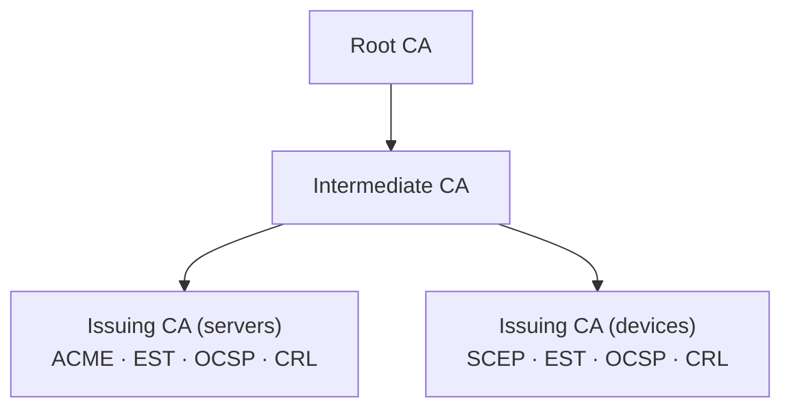

<p align="center">
  
</p>

<h1 align="center">h42-pki</h1>

**Home42 PKI**: a containerised certificate authority server written in Python.

Each container runs **one certificate authority (CA), i.e. one level of a PKI hierarchy**. Several identical
containers link to each other to form a hierarchy (root → intermediate → issuing CAs). Every level offers the same
services:

- **Revocation**: CRL and OCSP
- **Enrolment**: an admin REST API, plus the standard protocols **ACME**, **EST** and **SCEP**
- **Hierarchy**: a subordinate CA container enrols with its parent to get its CA certificate signed



Stack: Python ≥ 3.13 ([ADR-0014](docs/adr/0014-python-3-13.md)), FastAPI, Tortoise ORM (SQLite by default),
`cryptography`, Pydantic, Typer, uv. Each container serves **HTTP and HTTPS by itself**, without a reverse proxy: a
built-in launcher runs two Uvicorn listeners in one process ([ADR-0012](docs/adr/0012-http-https-integres.md)), and
the CA issues and renews the certificate of its own HTTPS server
([ADR-0013](docs/adr/0013-certificat-serveur-integre.md)).

> [!WARNING]
> **Early development, not for production use.**
> The admin API has **no authentication** until the first release ([ADR-0008](docs/adr/0008-api-admin-sans-authentification.md)):
> only expose it on `127.0.0.1` or on an internal container network. The database schema can change without migrations
> ([ADR-0007](docs/adr/0007-pas-de-migration-avant-release.md)): do not store a real CA in it.

## Quick start

Requirements: [uv](https://docs.astral.sh/uv/) (and [Podman](https://podman.io/), or Docker, for the container image).

```bash
uv sync --all-groups                               # install dependencies (runtime + dev)
export H42_PKI_CA_PASSPHRASE='change-me'           # passphrase used to encrypt private keys
export H42_PKI_SERVER_HOSTNAME=pki.home42.test     # FQDN of the service (CN of its HTTPS certificate)
export H42_PKI_SERVER_ALT_NAMES=localhost,127.0.0.1
export H42_PKI_ENVIRONMENT=dev
uv run h42pki serve --reload                       # HTTP on 127.0.0.1:8080; HTTPS on :8443 once the CA exists
```

Until a CA exists, only HTTP answers, with the public routes (`/`, `/health`, `/ca/*`). Create the root CA (once per
container) from another terminal, with the same variables: the server opens HTTPS **without restart**, with a
certificate issued by that CA (47 days, renewed automatically 15 days before expiry).

```bash
uv run h42pki authority init --name home42-root --common-name "Home42 Root CA"   # 10 years by default
uv run h42pki authority export --output root.pem
curl --cacert root.pem https://127.0.0.1:8443/health
```

The admin API (`/api/v1`) and its interactive docs (`https://127.0.0.1:8443/docs`) are served over **HTTPS only**.
Issue a TLS server certificate from a CSR:

```bash
openssl req -new -newkey ec -pkeyopt ec_paramgen_curve:prime256v1 -nodes \
  -keyout leaf.key -out leaf.csr -subj "/CN=www.home42.test" \
  -addext "subjectAltName=DNS:www.home42.test"
jq -n --rawfile csr leaf.csr '{csr_pem: $csr, profile: "tls_server"}' \
  | curl -s --cacert root.pem -H 'content-type: application/json' -d @- https://127.0.0.1:8443/api/v1/requests
# -> {"status": "issued", "certificate_id": "…", …}
curl -s --cacert root.pem -o leaf.pem https://127.0.0.1:8443/api/v1/certificates/<certificate_id>.pem
openssl verify -CAfile root.pem leaf.pem
```

> [!NOTE]
> On Windows, `curl` (Schannel) refuses certificates that carry no revocation information: create the CA with
> `--crl` or `--ocsp` and a public base URL (see [Revocation](#revocation)), or add `--ssl-no-revoke`.

Profiles decide what a certificate contains (`uv run h42pki profile list`): `tls_server` certificates last 90 days
(200 at most). A profile can be disabled on a CA (`h42pki profile disable device`). Certificates are listed with
`uv run h42pki certificate list` or `GET /api/v1/certificates`.

With a public base URL (`--public-base-url` at `authority init`, or `h42pki authority update`), the CA certificate is
published over plain HTTP and issued certificates point to it (AIA caIssuers):

```bash
uv run h42pki authority update --public-base-url http://127.0.0.1:8080
curl -s http://127.0.0.1:8080/ca/home42-root.crt | openssl x509 -inform DER -noout -subject
curl -s -o chain.pem http://127.0.0.1:8080/ca/chain.pem   # CA chain, root included
openssl verify -CAfile chain.pem leaf.pem
```

### Revocation

CRL and OCSP are **chosen when the CA is created** and cannot be changed afterwards
([ADR-0017](docs/adr/0017-revocation.md)); both are off by default. With a public base URL, every certificate the CA
issues then carries a CRL distribution point and/or an OCSP URL. Revocation is final (no `certificateHold`).

```bash
uv run h42pki authority init --name home42-root --common-name "Home42 Root CA" \
  --crl --ocsp --public-base-url http://127.0.0.1:8080
# … issue leaf.pem as above, then revoke it (API: POST /api/v1/certificates/<id>/revoke)
uv run h42pki certificate list                      # the ID column
uv run h42pki certificate revoke <id> --reason key_compromise
uv run h42pki crl show                              # number, dates, revoked serials
curl -s http://127.0.0.1:8080/crl/home42-root.crl | openssl crl -inform DER -noout -text
openssl verify -crl_check -CAfile root.pem \
  -CRLfile <(curl -s http://127.0.0.1:8080/crl/home42-root.crl | openssl crl -inform DER) leaf.pem
# -> error 23 at 0 depth lookup: certificate revoked
openssl ocsp -issuer root.pem -cert leaf.pem -url http://127.0.0.1:8080/ocsp -CAfile root.pem
# -> leaf.pem: revoked
```

The CRL is regenerated at each revocation and every 15 minutes when due (`crl.validity_hours`, 168 by default);
OCSP answers are signed by the CA key and cached when they carry no nonce. A subordinate CA checks its own status with
the OCSP of its parent every day (`h42pki authority check-parent` to do it now): once revoked, it stops issuing.

### EST enrollment

EST (RFC 7030) is **disabled by default**, like every enrollment protocol
([ADR-0018](docs/adr/0018-est.md)). It is served over HTTPS only, under `/.well-known/est/{profile}/…`.

```bash
uv run h42pki config set est.enabled true
uv run h42pki est account create router-01          # the generated password is shown once, on stdout
openssl req -new -newkey ec -pkeyopt ec_paramgen_curve:prime256v1 -nodes -keyout est.key \
  -outform DER -out est.der -subj "/CN=www.home42.test" -addext "subjectAltName=DNS:www.home42.test"
base64 est.der > est.b64
curl -s --cacert root.pem -u router-01 -H 'Content-Type: application/pkcs10' --data-binary @est.b64 \
  https://127.0.0.1:8443/.well-known/est/tls_server/simpleenroll |
  base64 -d | openssl pkcs7 -inform DER -print_certs   # curl -u asks for the password
```

A profile that needs a manual approval answers `202` with `Retry-After`: send the same request again after
`h42pki request approve`. `simplereenroll` authenticates with the client certificate only (same subject and SANs),
`csrattrs` lists what the profile requires, and `serverkeygen` returns a key generated by the server, delivered
once; its encrypted copy can be deleted with `h42pki certificate delete-key ID`.

### Container (Podman)

Podman (rootless) is the reference container engine; Docker works the same way (`docker` instead of `podman`).

```bash
make image                       # podman build --format docker (keeps the HEALTHCHECK)
podman run -d --name h42pki \
  -e H42_PKI_CA_PASSPHRASE='change-me' \
  -e H42_PKI_SERVER_HOSTNAME=pki.home42.lan \
  -e H42_PKI_SERVER_ALT_NAMES=localhost,127.0.0.1 \
  -v h42pki-data:/data -p 127.0.0.1:8080:8080 -p 127.0.0.1:8443:8443 \
  gilles67/h42-pki:latest
podman exec h42pki h42pki authority init --name home42-root --common-name "Home42 Root CA"
podman exec h42pki h42pki authority export > root.pem
curl --cacert root.pem https://localhost:8443/health
```

Rootless Podman cannot publish ports below 1024 by default: keep 8080/8443 on the host, or lower
`net.ipv4.ip_unprivileged_port_start`. Run `loginctl enable-linger $USER` so that containers survive the end of
your session.

The container is `healthy` when the database answers and the launcher is alive (`h42pki healthcheck`, independent of
the ports). With `H42_PKI_HTTP_ENABLED=false` and `H42_PKI_HTTPS_ENABLED=false` it serves nothing on the network
(idle mode, for example an offline root) and stays usable through `podman exec`. A CA created with `--crl` or
`--ocsp` refuses idle mode: an offline root is created without them.

The admin API has no authentication yet: keep the ports on `127.0.0.1` or on an internal network.

### Hierarchy

A container becomes the child of another one with a **single-use invitation**: the child pins the fingerprint of the
parent CA, then enrols over HTTPS ([ADR-0015](docs/adr/0015-federation-invitations.md)).

```bash
# On the parent: prints the token (once, on stdout), the fingerprint and the command to run
h42pki federation invite --path-length 0
# On the child: the token is read on standard input and never stored
h42pki authority init --name issuing --common-name "Issuing CA" \
  --parent-url https://root.pki.test:8443 --parent-fingerprint <sha256> --token -
# On the parent, unless the invitation was created with --auto-approve
h42pki request list --status pending
h42pki request approve <id>
```

[`deploy/`](deploy/README.md) builds a root → intermediate → issuing hierarchy with `podman-compose` (or Docker Compose),
every CA with CRL and OCSP; `deploy/est-test.sh` then exercises EST on the issuing CA (curl, openssl, optionally
`estclient`), `deploy/scep-test.sh` SCEP with `sscep`, `deploy/acme-test.sh` ACME with `lego` and `certbot`, and
`deploy/revocation-test.sh` checks revocation with `openssl`.

### SCEP

SCEP is disabled by default; once enabled, the CA issues a dedicated RA certificate (its own key never decrypts nor
signs anything for SCEP) and devices enrol with a challenge generated by the server:

```bash
h42pki config set scep.enabled true
h42pki scep challenge create              # single use, printed once; --reusable for a fleet
sscep getca  -u http://pki.example:8080/scep/tls_client -c ca.crt     # CA and RA: ca.crt-0, ca.crt-1…
sscep enroll -u http://pki.example:8080/scep/tls_client -c ra.crt -e ra.crt \
  -k device.key -r device.csr -l device.crt -E aes256 -S sha256        # challengePassword in device.csr
```

### ACME

ACME is disabled by default and served over HTTPS only, one directory per profile (`/acme/directory` is
`tls_server`: 47-day certificates). Challenges: http-01 and dns-01 (wildcards), IP addresses with http-01. Any
client can open an account, and the challenge alone decides: there is no domain restriction yet.

```bash
h42pki config set acme.enabled true
# lego, trusting the root of the hierarchy, answering http-01 on port 80 of www.example.test
LEGO_CA_CERTIFICATES=root.pem lego run --server https://pki.example:8443/acme/directory \
  --accept-tos --email admin@example.test --domains www.example.test --http
# certbot
REQUESTS_CA_BUNDLE=root.pem certbot certonly --standalone \
  --server https://pki.example:8443/acme/directory -d www.example.test
```

### Configuration

A fixed list of environment variables, read at start-up; each secret can also be given as a file, either with
`H42_PKI_<NAME>_FILE` or as a container secret (Podman or Docker) in `/run/secrets/h42_pki_<name>` (directory configurable with
`H42_PKI_SECRETS_DIR`):

| Variable | Default | Description |
|---|---|---|
| `H42_PKI_CA_PASSPHRASE` | *(required by the server)* | Passphrase that encrypts the private keys |
| `H42_PKI_SERVER_HOSTNAME` | *(required by the server)* | FQDN of the service: CN and first SAN of its HTTPS certificate |
| `H42_PKI_SERVER_ALT_NAMES` | empty | Extra DNS names / IP addresses for the HTTPS certificate, comma-separated |
| `H42_PKI_DATABASE_URL` | `sqlite://data/h42pki.sqlite3` (`sqlite:///data/…` in the image) | Tortoise database URL |
| `H42_PKI_ENVIRONMENT` | `production` | `dev`, `test` or `production` |
| `H42_PKI_BIND_ADDRESS` | `127.0.0.1` (`0.0.0.0` in the image) | Listen address |
| `H42_PKI_HTTP_ENABLED` / `H42_PKI_HTTP_PORT` | `true` / `8080` | HTTP listener (public routes only) |
| `H42_PKI_HTTPS_ENABLED` / `H42_PKI_HTTPS_PORT` | `true` / `8443` | HTTPS listener (everything, optional client certificates) |
| `H42_PKI_TRUSTED_PROXIES` | empty | CIDRs of trusted reverse proxies (`Client-Cert` header); none by default |

Everything else lives in the database (one file to back up, plus the passphrase), edited with the CLI and read by
`GET /api/v1/config`:

```bash
uv run h42pki config show                              # value, default, origin, application level
uv run h42pki config set server.tls_min_version tls1.3 # -> the HTTPS listener restarts by itself
uv run h42pki config unset server.tls_min_version
```

## Development

| Command | Purpose |
|---|---|
| `make install` | `uv sync --all-groups` |
| `make fmt` | auto-fix and format with ruff |
| `make lint` | ruff check and format check |
| `make typecheck` | mypy |
| `make test` | pytest (interop tests excluded) |
| `make check` | lint + typecheck + test |
| `make run` | dev server with auto-reload (`h42pki serve --reload`) |

CI (GitHub Actions) runs lint and type checking on Python 3.13, tests on Python 3.13 and 3.14.

## Roadmap

| Phase | Content | Status |
|---|---|---|
| 0 | Clean-up: installable package, settings, tooling, tests, container image, CI | ✅ done |
| 1 | CA core: key store, certificate profiles, single issuance path, data model, admin API, CLI, AIA publication | ✅ done |
| 1.1 | Operations base: Python 3.13, configuration in the database, built-in HTTP/HTTPS launcher, self-issued HTTPS certificate, health check | ✅ done |
| 2 | Hierarchy: subordinate CA enrolment with its parent (federation), multi-level compose (`podman-compose`) | ✅ done |
| 3 | Revocation: CRL and OCSP chosen per CA, revocation API and CLI, child CA status check | ✅ done |
| 4 | EST enrolment (RFC 7030): accounts, simpleenroll, simplereenroll, csrattrs, serverkeygen; disabled by default | ✅ done |
| 5 | SCEP enrolment (RFC 8894): dedicated RA, generated challenges, polling, renewal; disabled by default | ✅ done |
| 6 | ACME (RFC 8555): 6a done (accounts, orders, http-01, dns-01 and wildcards, IP addresses, revocation); 6b: keyChange, EAB, renewal info; disabled by default | 🚧 6b next |
| 7 | Hardening: PKCS#11 (smart card / HSM), PostgreSQL, metrics, CA key rollover, operations runbook | ⏳ |

**First release** requires, on top of the phases above: database migrations and admin API authentication.

Details: [`docs/roadmap.md`](docs/roadmap.md).

## Documentation

The design documentation is in French, in [`docs/`](docs/):

- [`ARCHITECTURE.md`](docs/ARCHITECTURE.md): overall design, components, data model, deployment
- [`protocols/`](docs/protocols/): federation, CRL, OCSP, EST, SCEP, ACME
- [`adr/`](docs/adr/): architecture decision records
- [`testing.md`](docs/testing.md), [`etat-des-lieux.md`](docs/etat-des-lieux.md) (review of the existing code)
- [`spikes/`](docs/spikes/): experiment reports (built-in HTTP/HTTPS launcher and client certificates)

## License

[MIT](LICENSE)
