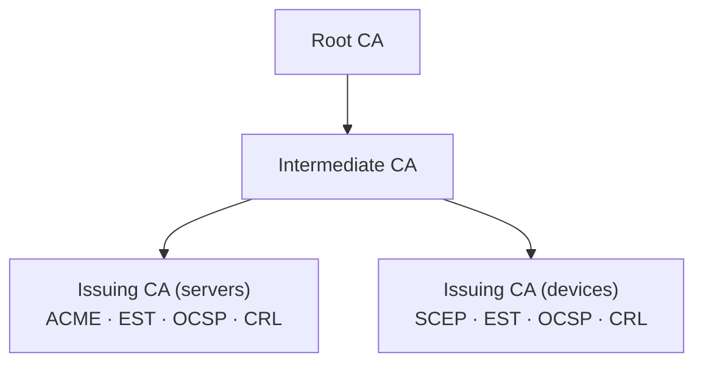

# h42-pki

**Home42 PKI**: a containerised certificate authority server written in Python.

Each container runs **one certificate authority (CA), i.e. one level of a PKI hierarchy**. Several identical
containers link to each other to form a hierarchy (root → intermediate → issuing CAs). Every level offers the same
services:

- **Revocation**: CRL and OCSP
- **Enrolment**: an admin REST API, plus the standard protocols **ACME**, **EST** and **SCEP**
- **Hierarchy**: a subordinate CA container enrols with its parent to get its CA certificate signed



Stack: Python ≥ 3.12, FastAPI, Tortoise ORM (SQLite by default), `cryptography`, Pydantic, Typer, uv.

> [!WARNING]
> **Early development, not for production use.**
> The admin API has **no authentication** until the first release ([ADR-0008](docs/adr/0008-api-admin-sans-authentification.md)):
> only expose it on `127.0.0.1` or on an internal Docker network. The database schema can change without migrations
> ([ADR-0007](docs/adr/0007-pas-de-migration-avant-release.md)): do not store a real CA in it.

## Quick start

Requirements: [uv](https://docs.astral.sh/uv/) (and Docker for the container image).

```bash
uv sync --all-groups                      # install dependencies (runtime + dev)
export H42_PKI_CA_PASSPHRASE='change-me'  # passphrase used to encrypt private keys
export H42_PKI_ENVIRONMENT=dev
uv run h42pki serve --reload              # http://127.0.0.1:8000, health check at /health
```

The interactive API docs are then served at `http://127.0.0.1:8000/docs`.

### Docker

```bash
make docker-build
docker run --rm -p 127.0.0.1:8000:8000 \
  -e H42_PKI_CA_PASSPHRASE='change-me' \
  -v h42pki-data:/data \
  gilles67/h42-pki:latest
```

### Configuration

Settings are read from `H42_PKI_*` environment variables. Each secret can also be given as a file, either with
`H42_PKI_<NAME>_FILE` or as a Docker secret in `/run/secrets/h42_pki_<name>` (directory configurable with
`H42_PKI_SECRETS_DIR`).

| Variable | Default | Description |
|---|---|---|
| `H42_PKI_CA_PASSPHRASE` | *(required)* | Passphrase that encrypts the private keys |
| `H42_PKI_DATABASE_URL` | `sqlite://data/h42pki.sqlite3` (`/data/…` in the image) | Tortoise database URL |
| `H42_PKI_ENVIRONMENT` | `production` | `dev`, `test` or `production` |

## Development

| Command | Purpose |
|---|---|
| `make install` | `uv sync --all-groups` |
| `make fmt` | auto-fix and format with ruff |
| `make lint` | ruff check and format check |
| `make typecheck` | mypy |
| `make test` | pytest (interop tests excluded) |
| `make check` | lint + typecheck + test |
| `make run` | dev server with auto-reload |

CI (GitHub Actions) runs lint, type checking and tests on Python 3.12 and 3.13.

## Roadmap

| Phase | Content | Status |
|---|---|---|
| 0 | Clean-up: installable package, settings, tooling, tests, Docker image, CI | ✅ done |
| 1 | CA core: key store, certificate profiles, single issuance path, data model, admin API, CLI, AIA publication | 🚧 in progress: data model, key store (RSA/EC/Ed25519, encrypted PKCS#8), self-signed root CA and admin API done; profiles, issuance from a CSR, CLI and AIA next |
| 2 | Hierarchy: subordinate CA enrolment with its parent (federation), multi-level `docker compose` | ⏳ |
| 3 | Revocation: CRL (full/delta) and OCSP responder | ⏳ |
| 4 | EST enrolment (RFC 7030) | ⏳ |
| 5 | SCEP enrolment (RFC 8894) | ⏳ |
| 6 | ACME (RFC 8555): http-01, dns-01, then tls-alpn-01, EAB, renewal info | ⏳ |
| 7 | Hardening: PKCS#11 (smart card / HSM), PostgreSQL, metrics, CA key rollover, operations runbook | ⏳ |

**First release** requires, on top of the phases above: database migrations and admin API authentication.

Details: [`docs/roadmap.md`](docs/roadmap.md).

## Documentation

The design documentation is in French, in [`docs/`](docs/):

- [`ARCHITECTURE.md`](docs/ARCHITECTURE.md): overall design, components, data model, deployment
- [`protocols/`](docs/protocols/): federation, CRL, OCSP, EST, SCEP, ACME
- [`adr/`](docs/adr/): architecture decision records
- [`testing.md`](docs/testing.md), [`etat-des-lieux.md`](docs/etat-des-lieux.md) (review of the existing code)

## License

[MIT](LICENSE)
