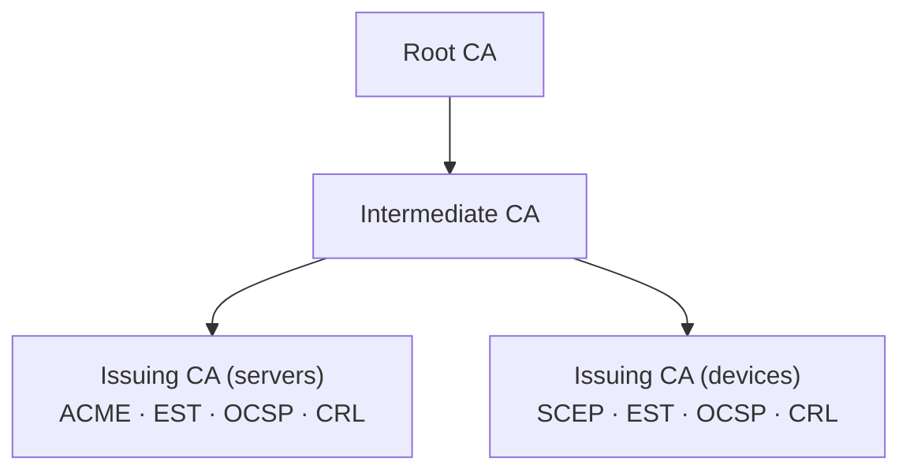

# h42-pki

**Home42 PKI**: a containerised certificate authority server written in Python.

Each container runs **one certificate authority (CA), i.e. one level of a PKI hierarchy**. Several identical
containers link to each other to form a hierarchy (root → intermediate → issuing CAs). Every level offers the same
services:

- **Revocation**: CRL and OCSP
- **Enrolment**: an admin REST API, plus the standard protocols **ACME**, **EST** and **SCEP**
- **Hierarchy**: a subordinate CA container enrols with its parent to get its CA certificate signed



Stack: Python ≥ 3.12 (3.13 from the next lot, [ADR-0014](docs/adr/0014-python-3-13.md)), FastAPI, Tortoise ORM
(SQLite by default), `cryptography`, Pydantic, Typer, uv.

> [!WARNING]
> **Early development, not for production use.**
> The admin API has **no authentication** until the first release ([ADR-0008](docs/adr/0008-api-admin-sans-authentification.md)):
> only expose it on `127.0.0.1` or on an internal Docker network. The database schema can change without migrations
> ([ADR-0007](docs/adr/0007-pas-de-migration-avant-release.md)): do not store a real CA in it.

## Quick start

Requirements: [uv](https://docs.astral.sh/uv/) (and Docker for the container image).

```bash
uv sync --all-groups                      # install dependencies (runtime + dev)
export H42_PKI_CA_PASSPHRASE='change-me'  # passphrase used to encrypt private keys
export H42_PKI_ENVIRONMENT=dev
uv run h42pki serve --reload              # http://127.0.0.1:8000, health check at /health
```

The interactive API docs are then served at `http://127.0.0.1:8000/docs`.

Create the root CA (once per container), then issue a TLS server certificate from a CSR:

```bash
uv run h42pki authority init --name home42-root --common-name "Home42 Root CA"   # 10 years by default
uv run h42pki authority export --output root.pem
openssl req -new -newkey ec -pkeyopt ec_paramgen_curve:prime256v1 -nodes \
  -keyout leaf.key -out leaf.csr -subj "/CN=www.home42.test" \
  -addext "subjectAltName=DNS:www.home42.test"
jq -n --rawfile csr leaf.csr '{csr_pem: $csr, profile: "tls_server"}' \
  | curl -s -H 'content-type: application/json' -d @- http://127.0.0.1:8000/api/v1/requests
# -> {"status": "issued", "certificate_id": "…", …}
curl -s -o leaf.pem http://127.0.0.1:8000/api/v1/certificates/<certificate_id>.pem
openssl verify -CAfile root.pem leaf.pem
```

Profiles decide what a certificate contains (`uv run h42pki profile list`): `tls_server` certificates last 90 days
(200 at most). Certificates are listed with `uv run h42pki certificate list` or `GET /api/v1/certificates`.

With a public base URL (`--public-base-url` at `authority init`, or `h42pki authority update`), the CA certificate is
published over plain HTTP and issued certificates point to it (AIA caIssuers):

```bash
uv run h42pki authority update --public-base-url http://127.0.0.1:8000
curl -s http://127.0.0.1:8000/ca/home42-root.crt | openssl x509 -inform DER -noout -subject
curl -s -o chain.pem http://127.0.0.1:8000/ca/chain.pem   # CA chain, root included
openssl verify -CAfile chain.pem leaf.pem
```

### Docker

```bash
make docker-build
docker run -d --name h42pki -p 127.0.0.1:8000:8000 \
  -e H42_PKI_CA_PASSPHRASE='change-me' \
  -v h42pki-data:/data \
  gilles67/h42-pki:latest
docker exec h42pki h42pki authority init --name home42-root --common-name "Home42 Root CA"
```

### Configuration

Settings are read from `H42_PKI_*` environment variables. Each secret can also be given as a file, either with
`H42_PKI_<NAME>_FILE` or as a Docker secret in `/run/secrets/h42_pki_<name>` (directory configurable with
`H42_PKI_SECRETS_DIR`).

| Variable | Default | Description |
|---|---|---|
| `H42_PKI_CA_PASSPHRASE` | *(required)* | Passphrase that encrypts the private keys |
| `H42_PKI_DATABASE_URL` | `sqlite://data/h42pki.sqlite3` (`/data/…` in the image) | Tortoise database URL |
| `H42_PKI_ENVIRONMENT` | `production` | `dev`, `test` or `production` |

### Coming next: built-in HTTP and HTTPS (phase 1.1)

The next lot makes each container self-sufficient, without a reverse proxy
([ADR-0011](docs/adr/0011-configuration-en-base.md) to [ADR-0013](docs/adr/0013-certificat-serveur-integre.md)):

- one process serves **HTTP** (public endpoints: `/ca/*`, later CRL, OCSP, SCEP) and **HTTPS** (everything,
  including the admin API, federation, EST and ACME), with optional client certificates (mTLS);
- as soon as the CA is active, it issues the certificate of its own HTTPS server (47 days, renewed automatically
  15 days before expiry) — even a root or intermediate CA does this, for its own server only;
- the whole configuration lives in the database (one file to back up, plus the passphrase), edited with
  `h42pki config`; only a fixed list of environment variables remains:

| Variable | Default | Description |
|---|---|---|
| `H42_PKI_CA_PASSPHRASE` | *(required)* | Passphrase that encrypts the private keys |
| `H42_PKI_SERVER_HOSTNAME` | *(required for the server)* | FQDN of the service: CN and first SAN of its HTTPS certificate |
| `H42_PKI_SERVER_ALT_NAMES` | empty | Extra DNS names / IP addresses for the HTTPS certificate, comma-separated |
| `H42_PKI_DATABASE_URL` | `sqlite:///data/h42pki.sqlite3` | Tortoise database URL |
| `H42_PKI_ENVIRONMENT` | `production` | `dev`, `test` or `production` |
| `H42_PKI_BIND_ADDRESS` | `0.0.0.0` in the image | Listen address |
| `H42_PKI_HTTP_ENABLED` / `H42_PKI_HTTP_PORT` | `true` / `8080` | HTTP listener |
| `H42_PKI_HTTPS_ENABLED` / `H42_PKI_HTTPS_PORT` | `true` / `8443` | HTTPS listener |
| `H42_PKI_TRUSTED_PROXIES` | empty | CIDRs of trusted reverse proxies (none by default) |

```bash
docker run -d --name pki-root \
  -e H42_PKI_CA_PASSPHRASE_FILE=/run/secrets/ca_passphrase \
  -e H42_PKI_SERVER_HOSTNAME=pki-root.home42.lan \
  -v pki-root-data:/data -p 80:8080 -p 443:8443 gilles67/h42-pki
```

## Development

| Command | Purpose |
|---|---|
| `make install` | `uv sync --all-groups` |
| `make fmt` | auto-fix and format with ruff |
| `make lint` | ruff check and format check |
| `make typecheck` | mypy |
| `make test` | pytest (interop tests excluded) |
| `make check` | lint + typecheck + test |
| `make run` | dev server with auto-reload |

CI (GitHub Actions) runs lint, type checking and tests on Python 3.12 and 3.13 (3.13 and 3.14 from phase 1.1).

## Roadmap

| Phase | Content | Status |
|---|---|---|
| 0 | Clean-up: installable package, settings, tooling, tests, Docker image, CI | ✅ done |
| 1 | CA core: key store, certificate profiles, single issuance path, data model, admin API, CLI, AIA publication | ✅ done |
| 1.1 | Operations base: Python 3.13, configuration in the database, built-in HTTP/HTTPS launcher, self-issued HTTPS certificate, health check | 🚧 next |
| 2 | Hierarchy: subordinate CA enrolment with its parent (federation), multi-level `docker compose` | ⏳ |
| 3 | Revocation: CRL (full/delta) and OCSP responder | ⏳ |
| 4 | EST enrolment (RFC 7030) | ⏳ |
| 5 | SCEP enrolment (RFC 8894) | ⏳ |
| 6 | ACME (RFC 8555): http-01, dns-01, then tls-alpn-01, EAB, renewal info | ⏳ |
| 7 | Hardening: PKCS#11 (smart card / HSM), PostgreSQL, metrics, CA key rollover, operations runbook | ⏳ |

**First release** requires, on top of the phases above: database migrations and admin API authentication.

Details: [`docs/roadmap.md`](docs/roadmap.md).

## Documentation

The design documentation is in French, in [`docs/`](docs/):

- [`ARCHITECTURE.md`](docs/ARCHITECTURE.md): overall design, components, data model, deployment
- [`protocols/`](docs/protocols/): federation, CRL, OCSP, EST, SCEP, ACME
- [`adr/`](docs/adr/): architecture decision records
- [`testing.md`](docs/testing.md), [`etat-des-lieux.md`](docs/etat-des-lieux.md) (review of the existing code)
- [`spikes/`](docs/spikes/): experiment reports (built-in HTTP/HTTPS launcher and client certificates)

## License

[MIT](LICENSE)
