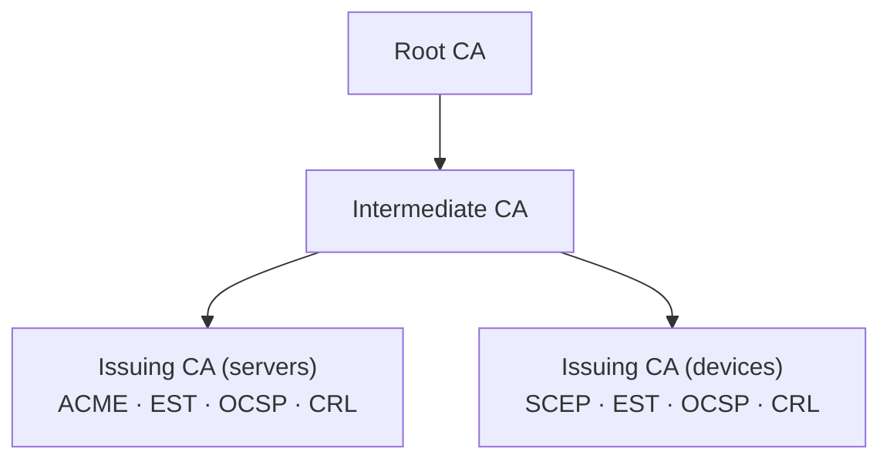

<p align="center">
  
</p>

<h1 align="center">h42-pki</h1>

**Home42 PKI**: a containerised certificate authority server written in Python.

Each container runs **one certificate authority (CA), i.e. one level of a PKI hierarchy**. Several identical
containers link to each other to form a hierarchy (root → intermediate → issuing CAs). Every level offers the same
services:

- **Revocation**: CRL and OCSP
- **Enrolment**: an admin REST API, plus the standard protocols **ACME**, **EST** and **SCEP**
- **Hierarchy**: a subordinate CA container enrols with its parent to get its CA certificate signed



Stack: Python ≥ 3.13 ([ADR-0014](docs/adr/0014-python-3-13.md)), FastAPI, Tortoise ORM (SQLite by default),
`cryptography`, Pydantic, Typer, uv. Each container serves **HTTP and HTTPS by itself**, without a reverse proxy: a
built-in launcher runs two Uvicorn listeners in one process ([ADR-0012](docs/adr/0012-http-https-integres.md)), and
the CA issues and renews the certificate of its own HTTPS server
([ADR-0013](docs/adr/0013-certificat-serveur-integre.md)).

> [!WARNING]
> **Early development, not for production use.**
> The admin API has **no authentication** until the first release ([ADR-0008](docs/adr/0008-api-admin-sans-authentification.md)):
> only expose it on `127.0.0.1` or on an internal Docker network. The database schema can change without migrations
> ([ADR-0007](docs/adr/0007-pas-de-migration-avant-release.md)): do not store a real CA in it.

## Quick start

Requirements: [uv](https://docs.astral.sh/uv/) (and Docker for the container image).

```bash
uv sync --all-groups                               # install dependencies (runtime + dev)
export H42_PKI_CA_PASSPHRASE='change-me'           # passphrase used to encrypt private keys
export H42_PKI_SERVER_HOSTNAME=pki.home42.test     # FQDN of the service (CN of its HTTPS certificate)
export H42_PKI_SERVER_ALT_NAMES=localhost,127.0.0.1
export H42_PKI_ENVIRONMENT=dev
uv run h42pki serve --reload                       # HTTP on 127.0.0.1:8080; HTTPS on :8443 once the CA exists
```

Until a CA exists, only HTTP answers, with the public routes (`/`, `/health`, `/ca/*`). Create the root CA (once per
container) from another terminal, with the same variables: the server opens HTTPS **without restart**, with a
certificate issued by that CA (47 days, renewed automatically 15 days before expiry).

```bash
uv run h42pki authority init --name home42-root --common-name "Home42 Root CA"   # 10 years by default
uv run h42pki authority export --output root.pem
curl --cacert root.pem https://127.0.0.1:8443/health
```

The admin API (`/api/v1`) and its interactive docs (`https://127.0.0.1:8443/docs`) are served over **HTTPS only**.
Issue a TLS server certificate from a CSR:

```bash
openssl req -new -newkey ec -pkeyopt ec_paramgen_curve:prime256v1 -nodes \
  -keyout leaf.key -out leaf.csr -subj "/CN=www.home42.test" \
  -addext "subjectAltName=DNS:www.home42.test"
jq -n --rawfile csr leaf.csr '{csr_pem: $csr, profile: "tls_server"}' \
  | curl -s --cacert root.pem -H 'content-type: application/json' -d @- https://127.0.0.1:8443/api/v1/requests
# -> {"status": "issued", "certificate_id": "…", …}
curl -s --cacert root.pem -o leaf.pem https://127.0.0.1:8443/api/v1/certificates/<certificate_id>.pem
openssl verify -CAfile root.pem leaf.pem
```

> [!NOTE]
> On Windows, `curl` (Schannel) refuses certificates that carry no revocation information until CRL and OCSP exist
> (phase 3): add `--ssl-no-revoke`.

Profiles decide what a certificate contains (`uv run h42pki profile list`): `tls_server` certificates last 90 days
(200 at most). A profile can be disabled on a CA (`h42pki profile disable device`). Certificates are listed with
`uv run h42pki certificate list` or `GET /api/v1/certificates`.

With a public base URL (`--public-base-url` at `authority init`, or `h42pki authority update`), the CA certificate is
published over plain HTTP and issued certificates point to it (AIA caIssuers):

```bash
uv run h42pki authority update --public-base-url http://127.0.0.1:8080
curl -s http://127.0.0.1:8080/ca/home42-root.crt | openssl x509 -inform DER -noout -subject
curl -s -o chain.pem http://127.0.0.1:8080/ca/chain.pem   # CA chain, root included
openssl verify -CAfile chain.pem leaf.pem
```

### Docker

```bash
make docker-build
docker run -d --name h42pki \
  -e H42_PKI_CA_PASSPHRASE='change-me' \
  -e H42_PKI_SERVER_HOSTNAME=pki.home42.lan \
  -e H42_PKI_SERVER_ALT_NAMES=localhost,127.0.0.1 \
  -v h42pki-data:/data -p 127.0.0.1:80:8080 -p 127.0.0.1:443:8443 \
  gilles67/h42-pki:latest
docker exec h42pki h42pki authority init --name home42-root --common-name "Home42 Root CA"
docker exec h42pki h42pki authority export > root.pem
curl --cacert root.pem https://localhost/health
```

The container is `healthy` when the database answers and the launcher is alive (`h42pki healthcheck`, independent of
the ports). With `H42_PKI_HTTP_ENABLED=false` and `H42_PKI_HTTPS_ENABLED=false` it serves nothing on the network
(idle mode, for example an offline root) and stays usable through `docker exec`.

The admin API has no authentication yet: keep the ports on `127.0.0.1` or on an internal network.

### Hierarchy

A container becomes the child of another one with a **single-use invitation**: the child pins the fingerprint of the
parent CA, then enrols over HTTPS ([ADR-0015](docs/adr/0015-federation-invitations.md)).

```bash
# On the parent: prints the token (once, on stdout), the fingerprint and the command to run
h42pki federation invite --path-length 0
# On the child: the token is read on standard input and never stored
h42pki authority init --name issuing --common-name "Issuing CA" \
  --parent-url https://root.pki.test:8443 --parent-fingerprint <sha256> --token -
# On the parent, unless the invitation was created with --auto-approve
h42pki request list --status pending
h42pki request approve <id>
```

[`deploy/`](deploy/README.md) builds a root → intermediate → issuing hierarchy with `docker compose`.

### Configuration

A fixed list of environment variables, read at start-up; each secret can also be given as a file, either with
`H42_PKI_<NAME>_FILE` or as a Docker secret in `/run/secrets/h42_pki_<name>` (directory configurable with
`H42_PKI_SECRETS_DIR`):

| Variable | Default | Description |
|---|---|---|
| `H42_PKI_CA_PASSPHRASE` | *(required by the server)* | Passphrase that encrypts the private keys |
| `H42_PKI_SERVER_HOSTNAME` | *(required by the server)* | FQDN of the service: CN and first SAN of its HTTPS certificate |
| `H42_PKI_SERVER_ALT_NAMES` | empty | Extra DNS names / IP addresses for the HTTPS certificate, comma-separated |
| `H42_PKI_DATABASE_URL` | `sqlite://data/h42pki.sqlite3` (`sqlite:///data/…` in the image) | Tortoise database URL |
| `H42_PKI_ENVIRONMENT` | `production` | `dev`, `test` or `production` |
| `H42_PKI_BIND_ADDRESS` | `127.0.0.1` (`0.0.0.0` in the image) | Listen address |
| `H42_PKI_HTTP_ENABLED` / `H42_PKI_HTTP_PORT` | `true` / `8080` | HTTP listener (public routes only) |
| `H42_PKI_HTTPS_ENABLED` / `H42_PKI_HTTPS_PORT` | `true` / `8443` | HTTPS listener (everything, optional client certificates) |
| `H42_PKI_TRUSTED_PROXIES` | empty | CIDRs of trusted reverse proxies (`Client-Cert` header); none by default |

Everything else lives in the database (one file to back up, plus the passphrase), edited with the CLI and read by
`GET /api/v1/config`:

```bash
uv run h42pki config show                              # value, default, origin, application level
uv run h42pki config set server.tls_min_version tls1.3 # -> the HTTPS listener restarts by itself
uv run h42pki config unset server.tls_min_version
```

## Development

| Command | Purpose |
|---|---|
| `make install` | `uv sync --all-groups` |
| `make fmt` | auto-fix and format with ruff |
| `make lint` | ruff check and format check |
| `make typecheck` | mypy |
| `make test` | pytest (interop tests excluded) |
| `make check` | lint + typecheck + test |
| `make run` | dev server with auto-reload (`h42pki serve --reload`) |

CI (GitHub Actions) runs lint and type checking on Python 3.13, tests on Python 3.13 and 3.14.

## Roadmap

| Phase | Content | Status |
|---|---|---|
| 0 | Clean-up: installable package, settings, tooling, tests, Docker image, CI | ✅ done |
| 1 | CA core: key store, certificate profiles, single issuance path, data model, admin API, CLI, AIA publication | ✅ done |
| 1.1 | Operations base: Python 3.13, configuration in the database, built-in HTTP/HTTPS launcher, self-issued HTTPS certificate, health check | ✅ done |
| 2 | Hierarchy: subordinate CA enrolment with its parent (federation), multi-level `docker compose` | ✅ done |
| 3 | Revocation: CRL (full/delta) and OCSP responder | 🚧 next |
| 4 | EST enrolment (RFC 7030) | ⏳ |
| 5 | SCEP enrolment (RFC 8894) | ⏳ |
| 6 | ACME (RFC 8555): http-01, dns-01, then tls-alpn-01, EAB, renewal info | ⏳ |
| 7 | Hardening: PKCS#11 (smart card / HSM), PostgreSQL, metrics, CA key rollover, operations runbook | ⏳ |

**First release** requires, on top of the phases above: database migrations and admin API authentication.

Details: [`docs/roadmap.md`](docs/roadmap.md).

## Documentation

The design documentation is in French, in [`docs/`](docs/):

- [`ARCHITECTURE.md`](docs/ARCHITECTURE.md): overall design, components, data model, deployment
- [`protocols/`](docs/protocols/): federation, CRL, OCSP, EST, SCEP, ACME
- [`adr/`](docs/adr/): architecture decision records
- [`testing.md`](docs/testing.md), [`etat-des-lieux.md`](docs/etat-des-lieux.md) (review of the existing code)
- [`spikes/`](docs/spikes/): experiment reports (built-in HTTP/HTTPS launcher and client certificates)

## License

[MIT](LICENSE)
