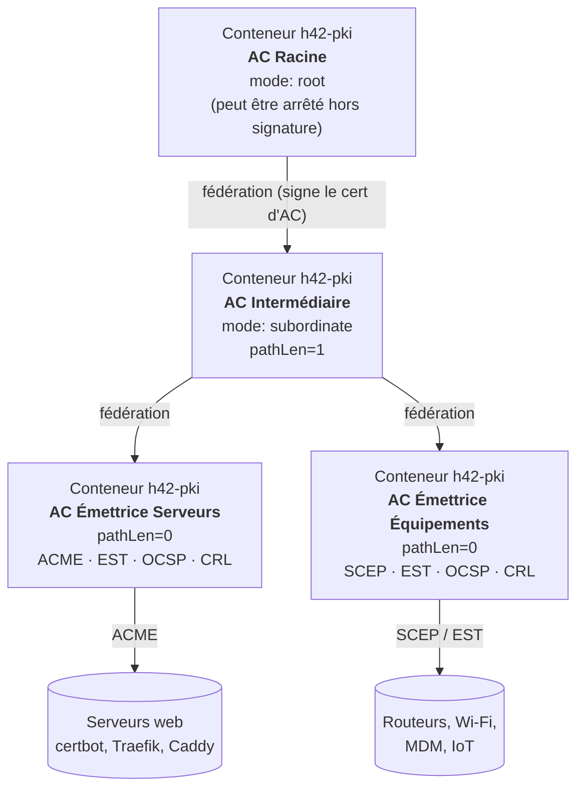
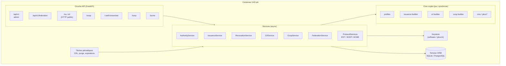
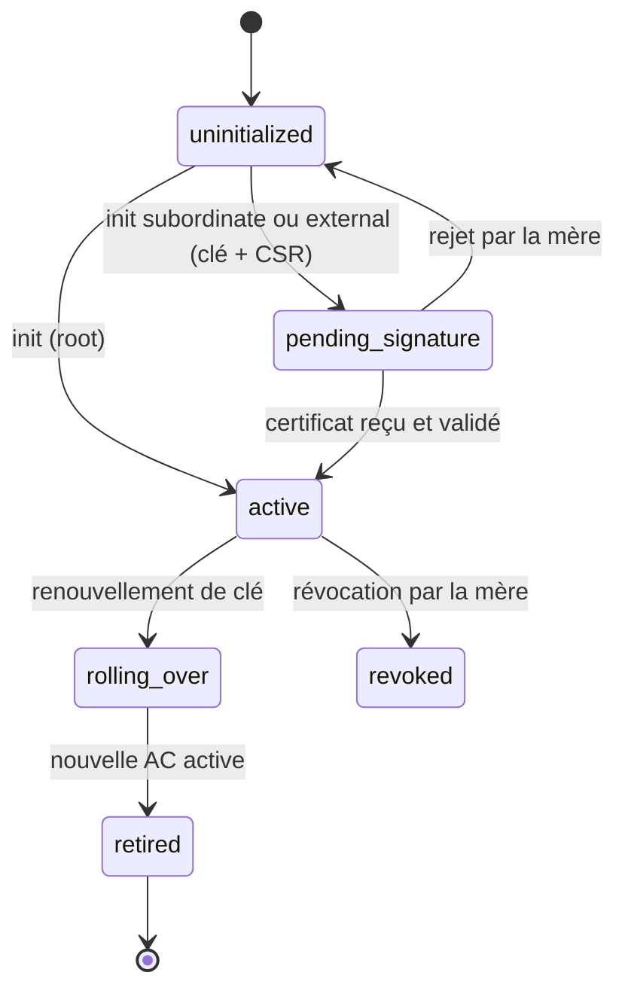
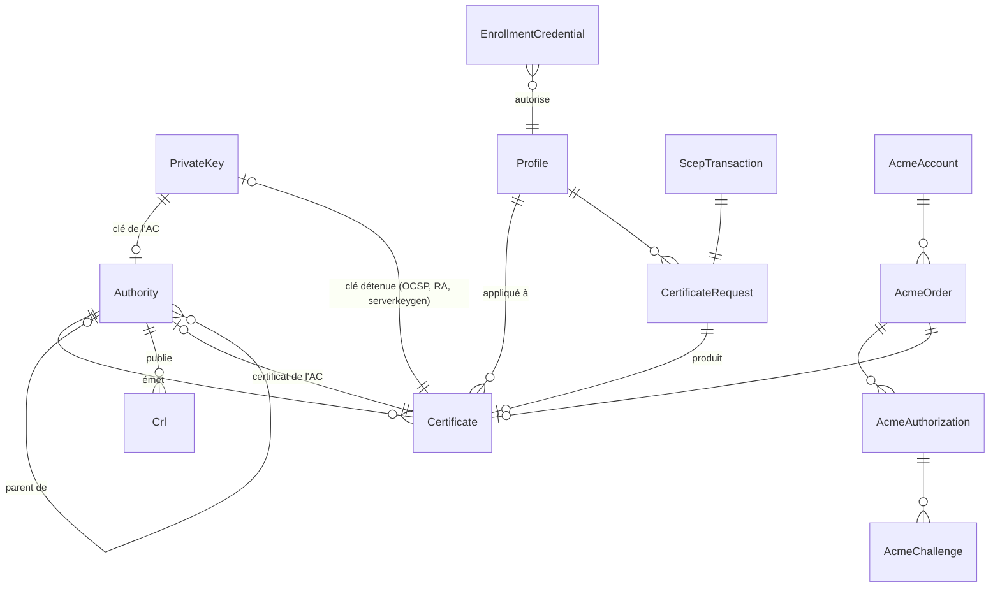
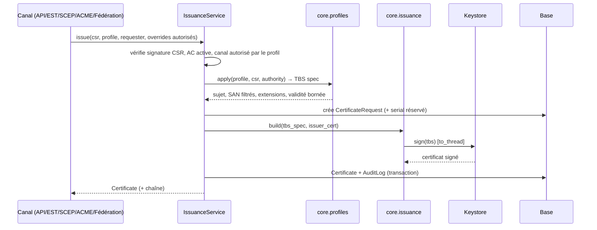

# Architecture — h42-pki

> Statut : **proposition v1** (2026-11). Les décisions structurantes sont tracées dans `docs/adr/`.
> Les points marqués **« À vérifier »** doivent être confirmés par un spike avant implémentation.

## 1. Objectifs

1. Fournir, dans **un conteneur**, une autorité de certification complète correspondant à **un niveau** de hiérarchie.
2. Permettre à plusieurs conteneurs identiques de **se chaîner** : un conteneur démarré en mode « fille » obtient
   son certificat d'AC auprès d'un conteneur « mère ».
3. Offrir à chaque niveau les services de **révocation** (CRL, OCSP) et d'**enrôlement** (API, EST, SCEP, ACME).
4. Rester exploitable en homelab (SQLite, un seul processus) tout en permettant un durcissement
   (PostgreSQL, clé sur carte à puce / HSM via PKCS#11).

### Non-objectifs (v1)

- Haute disponibilité multi-instance d'une même AC (une AC = un conteneur actif).
- Interface web graphique (l'API et la CLI suffisent ; une UI pourra venir plus tard).
- Certificats qualifiés eIDAS, Certificate Transparency, horodatage RFC 3161.

## 2. Vue d'ensemble

### 2.1 Hiérarchie type



Tous les conteneurs exécutent **la même image**. Seule la configuration (`mode`, URL de la mère, profils activés)
change. Chaque conteneur ne gère **qu'une seule AC active** à la fois (plus, temporairement, l'ancienne AC lors
d'un renouvellement de clé — voir §8.3).

### 2.2 Composants d'un conteneur



| Couche | Responsabilité | Règles |
|---|---|---|
| `api/` | HTTP : parsing, content-types, authentification, codes d'erreur | Aucune logique métier, aucun accès direct au keystore |
| `services/` | Orchestration : transactions DB, application des profils, audit | Async ; appelle `core` via `asyncio.to_thread` si coûteux |
| `core/` | Construction/vérification d'objets X.509, CRL, OCSP, CMS | Pur, synchrone, testable sans DB ni réseau |
| `keystore/` | Détention des clés privées, opérations de signature/déchiffrement | Seul composant qui touche une clé privée |
| `models/` | Persistance Tortoise | Aucun import de `api` |
| `tasks/` | Tâches planifiées (lifespan FastAPI) | Idempotentes |

## 3. Modes de fonctionnement d'un conteneur

| Mode | Initialisation | Peut signer des AC filles | Services d'enrôlement |
|---|---|---|---|
| `root` | Génère sa clé + certificat auto-signé | Oui (si `pathLen` > 0) | Désactivés par défaut |
| `subordinate` | Génère sa clé + CSR, s'inscrit auprès de la mère (fédération) | Oui si `pathLen` > 0 | Selon configuration |
| `external` | Importe un certificat d'AC signé par une AC tierce (CSR exporté manuellement) | Selon `pathLen` | Selon configuration |

Le mode `external` permet de rattacher h42-pki à une racine existante (AD CS, racine hors ligne sur clé USB, etc.).

Cycle de vie d'une AC locale (`Authority.status`) :



Tant que l'AC n'est pas `active`, seuls `/health`, l'API d'admin et la fédération répondent ;
les endpoints d'enrôlement renvoient `503`.

## 4. Modèle de données

### 4.1 Diagramme



### 4.2 Tables principales

Toutes les tables ont `id` (UUID), `created_at`, `updated_at` (UTC aware).

**`PrivateKey`** — clé détenue par ce conteneur.
`algorithm` (enum : `rsa2048|rsa3072|rsa4096|ec_p256|ec_p384|ed25519`), `backend` (`software|pkcs11`),
`encrypted_pkcs8` (binaire, backend software), `pkcs11_uri` (backend pkcs11), `public_key_der`,
`purpose` (`ca|ocsp|scep_ra|tls|serverkeygen`), `status`.

**`Authority`** — une AC connue de ce conteneur.
`kind` (`local|parent|child`), `name`, `status` (cf. §3), `certificate` → `Certificate`,
`private_key` → `PrivateKey` (local uniquement), `parent` → `Authority` (FK sur soi),
`path_length`, `public_base_url` (préfixe des URLs AIA/CDP/OCSP inscrites dans les certificats),
`federation_url` (pour `parent`/`child`), `name_constraints` (JSON).

**`Profile`** — gabarit d'émission (remplace l'actuel `Extension` libre).
`name` (unique), `kind` (`sub_ca|tls_server|tls_client|email|code_signing|ocsp_signer|device|custom`),
`validity_days`, `max_validity_days`, `key_usage` (JSON), `extended_key_usage` (liste d'OID),
`basic_constraints` (JSON), `allowed_key_algorithms` (liste), `subject_policy` (JSON : champs requis/autorisés/fixés),
`san_policy` (JSON : types autorisés, motifs de domaines), `include_cdp`, `include_aia`, `include_ocsp`,
`must_staple`, `enabled_channels` (`api|est|scep|acme|federation`).

**`Certificate`**
`issuer` → `Authority` (null = auto-signé), `serial_hex` (unique avec `issuer`), `subject_dn` (texte RFC 4514),
`subject` (JSON), `sans` (JSON), `profile` → `Profile`, `not_before`, `not_after`, `der`, `sha256_fingerprint` (unique),
`ski`, `aki`, `status` (`valid|revoked|expired|on_hold`), `revoked_at`, `revocation_reason` (enum RFC 5280),
`invalidity_date`, `private_key` → `PrivateKey` (null sauf certificats détenus localement),
`request` → `CertificateRequest`, `channel` (`api|est|scep|acme|federation|self`).

**`CertificateRequest`**
`csr_der`, `status` (`pending|approved|rejected|issued|failed`), `channel`, `profile`, `requester` (texte : identité
authentifiée), `approved_by`, `rejection_reason`, `metadata` (JSON propre au canal).

**`Crl`**
`authority`, `crl_number` (entier monotone par AC), `is_delta`, `base_crl_number`, `this_update`, `next_update`, `der`.
La CRL courante = la plus récente non expirée ; les anciennes sont conservées pour audit.

**`EnrollmentCredential`** — secrets d'enrôlement partagés par EST/SCEP/fédération.
`kind` (`est_basic|scep_challenge|federation_token|acme_eab`), `identifier`, `secret_hash` (argon2/scrypt ;
pour `acme_eab`, clé HMAC chiffrée car elle doit être relue), `profile`, `expires_at`, `max_uses`, `use_count`,
`allowed_subjects` (motif).

**`AuditLog`** — `timestamp`, `actor`, `action`, `object_type`, `object_id`, `details` (JSON, sans secret), `source_ip`.

Tables spécifiques aux protocoles (détails dans `docs/protocols/`) :
`ScepTransaction`, `AcmeAccount`, `AcmeOrder`, `AcmeAuthorization`, `AcmeChallenge`, `AcmeNonce`,
`ChildAuthorityEnrollment` (fédération).

### 4.3 Choix de persistance

- **Tortoise ORM** (déjà adopté). SQLite par défaut (`/data/h42pki.sqlite3`), PostgreSQL via `asyncpg` en option.
- Migrations : **aucune avant la première release** (ADR-0007), le schéma est créé par `generate_schemas=True`.
  Avant la release : **Aerich** ou outil natif de Tortoise 1.x (**À vérifier**), puis `generate_schemas` réservé aux tests.
- Les objets cryptographiques sont stockés en **DER** ; le PEM n'est produit qu'en sortie.
- Toute émission se fait dans une **transaction** (`in_transaction()`) : réservation du numéro de série, insertion,
  audit. Le numéro de CRL est incrémenté sous verrou (`select_for_update` en PostgreSQL ; processus unique en SQLite).

## 5. Flux principaux

### 5.1 Émission d'un certificat (tous canaux)

Tous les canaux d'enrôlement convergent vers **`IssuanceService.issue()`** : c'est le seul chemin d'émission.



Extensions ajoutées systématiquement par `core.issuance` (indépendamment du CSR) :
`AuthorityKeyIdentifier`, `SubjectKeyIdentifier`, et selon le profil `CRLDistributionPoints`
(`{public_base_url}/crl/{authority}.crl`), `AuthorityInformationAccess` (caIssuers `{public_base_url}/ca/{authority}.crt`,
OCSP `{public_base_url}/ocsp`).

### 5.2 Révocation

`RevocationService.revoke(cert, reason, invalidity_date)` → met à jour `Certificate`, journalise, puis
**déclenche la régénération immédiate de la CRL** (et invalide le cache OCSP). Accessible via l'API d'admin,
ACME `revokeCert`, et la fédération (révocation d'une AC fille par sa mère).

### 5.3 Inscription d'une AC fille

Voir `docs/protocols/federation.md`. Résumé : jeton d'inscription à usage unique créé sur la mère →
la fille génère clé + CSR et appelle `POST /api/v1/federation/enroll` → la mère applique le profil `sub_ca`
(contrôle `pathLen`, NameConstraints) → approbation automatique ou manuelle → la fille récupère certificat + chaîne.

## 6. Surface HTTP

| Préfixe | Transport | Auth | Contenu |
|---|---|---|---|
| `/health`, `/ready` | HTTP | aucune | statut JSON |
| `/ca/{name}.crt`, `/ca/{name}.pem`, `/ca/chain.pem` | **HTTP** | aucune | AIA caIssuers (DER), PEM, chaîne |
| `/crl/{name}.crl`, `/crl/{name}-delta.crl` | **HTTP** | aucune | CRL DER (`application/pkix-crl`) |
| `/ocsp` (POST), `/ocsp/{b64}` (GET) | HTTP | aucune | `application/ocsp-request` / `-response` |
| `/acme/...` | HTTPS | JWS (RFC 8555) | `application/jose+json` |
| `/.well-known/est/[{label}/]...` | **HTTPS** | mTLS ou Basic | PKCS#10 / PKCS#7 base64 |
| `/scep[/{profile}]` (`pkiclient.exe` accepté) | HTTP | challenge password | CMS (`application/x-pki-message`) |
| `/api/v1/federation/...` | HTTPS | jeton puis mTLS | JSON |
| `/api/v1/...` | HTTPS | aucune avant la release (ADR-0008), puis jeton d'API (Bearer) | JSON |
| `/metrics` | HTTP interne | aucune / réseau privé | Prometheus (phase 7) |

**TLS et mTLS.** Le serveur ASGI (Granian ou Uvicorn) peut terminer TLS lui-même, mais l'accès au certificat client
dans FastAPI dépend du serveur — **À vérifier**. Choix retenu pour v1 (cf. ADR-0005) : un **reverse-proxy**
(Traefik / Caddy / nginx) termine TLS et mTLS et transmet le certificat client dans un en-tête
(`X-Client-Cert`, PEM url-encodé). L'application n'accepte cet en-tête que si la requête provient d'une adresse
listée dans `trusted_proxies`. Un mode « TLS direct » pourra être ajouté ensuite.

Les endpoints HTTP (AIA/CRL/OCSP/SCEP) et HTTPS peuvent être exposés sur deux ports distincts (80/443) par le proxy.

## 7. Configuration

`pydantic-settings` (déjà présent dans `uv.lock`) : fichier TOML (`/config/h42pki.toml`, chemin surchargé par
`H42_PKI_CONFIG`) + variables d'environnement `H42_PKI_*` (priorité aux variables). Tout secret accepte une variante
`*_FILE` (Docker secrets).

```toml
[authority]
mode = "subordinate"            # root | subordinate | external
name = "home42-issuing-servers" # identifiant court, utilisé dans les URLs
public_base_url = "http://pki-srv.home42.lan"
key_algorithm = "ec_p384"
validity_days = 3650
path_length = 0

[authority.subject]
country_name = "FR"
organization_name = "Home42"
common_name = "Home42 Issuing CA - Servers"

[parent]                        # mode subordinate uniquement
federation_url = "https://pki-int.home42.lan"
enrollment_token_file = "/run/secrets/federation_token"
ca_bundle = "/config/parent-root.pem"   # ancre de confiance pour joindre la mère

[keystore]
backend = "software"            # software | pkcs11
passphrase_file = "/run/secrets/ca_passphrase"

[database]
url = "sqlite:///data/h42pki.sqlite3"

[crl]
validity_hours = 168
regenerate_before_hours = 48
delta_enabled = false

[ocsp]
enabled = true
responder = "delegated"         # delegated | ca
response_validity_hours = 24

[est]
enabled = true
[scep]
enabled = false
[acme]
enabled = true
default_profile = "tls_server"
require_eab = false

[server]
trusted_proxies = ["172.16.0.0/12"]
```

## 8. Sécurité

### 8.1 Clés privées

- Interface `KeyBackend` (`keystore/base.py`) : `generate(algorithm, purpose)`, `sign(key_ref, data, hash)`,
  `decrypt(key_ref, data, padding)` (SCEP), `public_key(key_ref)`, `load_for_cryptography(key_ref)`.
- **Backend logiciel (v1)** : PKCS#8 chiffré (`BestAvailableEncryption`) avec la passphrase du conteneur, stocké en base.
  La passphrase ne réside qu'en mémoire.
- **Backend PKCS#11 (phase 7)** : l'image contient déjà OpenSC et `PyKCS11`. **Risque identifié** : `cryptography`
  n'accepte pas d'objet clé externe pour `CertificateBuilder.sign()` / `CertificateRevocationListBuilder.sign()` /
  `OCSPResponseBuilder.sign()`. Il faudra soit construire le TBS avec `asn1crypto`/`pyasn1` et y injecter la signature
  produite par le jeton, soit utiliser une bibliothèque tierce. **Spike obligatoire avant la phase 7**
  (cf. ADR-0004). C'est la raison pour laquelle toute signature passe par `keystore` dès la v1.

### 8.2 Clés de service

Pour limiter l'usage de la clé de l'AC :

- **Répondeur OCSP délégué** : certificat dédié (EKU `id-kp-OCSPSigning`, extension `id-pkix-ocsp-nocheck`,
  validité courte, renouvelé automatiquement).
- **Certificat RA SCEP** : clé RSA dédiée (le chiffrement CMS exige RSA + `keyEncipherment`), signée par l'AC.

### 8.3 Renouvellement de l'AC

Renouvellement avec **nouvelle clé** (rollover) : l'ancienne AC passe `rolling_over` puis `retired` ; elle continue à
publier sa CRL et à répondre en OCSP pour ses certificats jusqu'à expiration du dernier certificat émis.
Les URLs incluent le nom de l'AC (`/crl/{name}.crl`) et non un nom générique, pour que plusieurs générations
coexistent. Règle : une AC n'émet pas de certificat dont `not_after` dépasse le sien.

### 8.4 Authentification

| Canal | Mécanisme |
|---|---|
| API admin | **aucune jusqu'à la première release (ADR-0008)** ; ensuite jetons Bearer (hachés en base, portée `admin` / `operator` / `read`), créés par CLI |
| Fédération | jeton d'inscription à usage unique, puis mTLS avec le certificat d'AC de la fille |
| EST | certificat client (réenrôlement, ou certificat émis par une AC de confiance configurée) ou HTTP Basic |
| SCEP | challenge password (à usage unique, expirant, lié à un profil) ; renouvellement signé par l'ancien certificat |
| ACME | JWS de compte ; EAB (RFC 8555 §7.3.4) optionnel pour restreindre l'ouverture de compte |

## 9. Déploiement

- Image unique basée sur `python:3.12-slim` (au lieu d'`ubuntu` + venv manuel), installation via `uv`, utilisateur
  non-root, `HEALTHCHECK`, volumes `/data` (base) et `/config` (configuration, secrets). OpenSC/pcscd seulement dans une
  variante `-pkcs11` de l'image.
- Serveur ASGI : **Granian** (déjà dans `requirements.txt`) ou Uvicorn — **un seul worker** en v1 (les tâches
  planifiées tournent dans le lifespan ; plusieurs workers dupliqueraient la génération de CRL).
- `deploy/compose.yaml` : racine + intermédiaire + émettrice + Traefik, pour le développement et les tests d'interop.
- Sauvegarde : base + configuration ; la perte de la passphrase rend la clé d'AC irrécupérable (à documenter
  dans un runbook d'exploitation).

## 10. Choix techniques

| Besoin | Choix | Remarque |
|---|---|---|
| X.509, CSR, CRL, OCSP | `cryptography` ≥ 48 | `x509.ocsp` couvre requêtes et réponses |
| PKCS#7 certs-only (EST, SCEP GetCACert) | `cryptography.hazmat.primitives.serialization.pkcs7` | `serialize_certificates` |
| CMS SignedData/EnvelopedData (SCEP) | `asn1crypto` pour la structure + `cryptography` pour la crypto | Le support CMS de `cryptography` ne lit pas les attributs authentifiés SCEP — **À vérifier** l'étendue exacte en v48 |
| JWS/JWK (ACME) | `joserfc` (ou `josepy`) | Choix à confirmer en phase 6 ; JWS ACME = flattened JSON |
| Validation ACME | `httpx` (http-01), `dnspython` (dns-01), `ssl` (tls-alpn-01) | `httpx` et `dnspython` déjà présents via fastapi[standard] |
| Config | `pydantic-settings` | déjà présent |
| Hachage de secrets | `argon2-cffi` (ou `hashlib.scrypt`) | |
| CLI | Typer | existant |
| Tests | pytest, pytest-asyncio, httpx, time-machine, pytest-cov | voir `docs/testing.md` |
| Qualité | ruff, mypy | |
