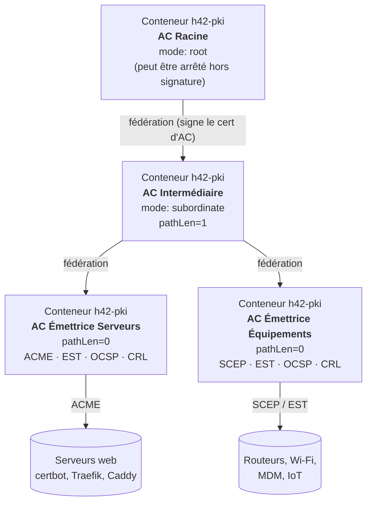
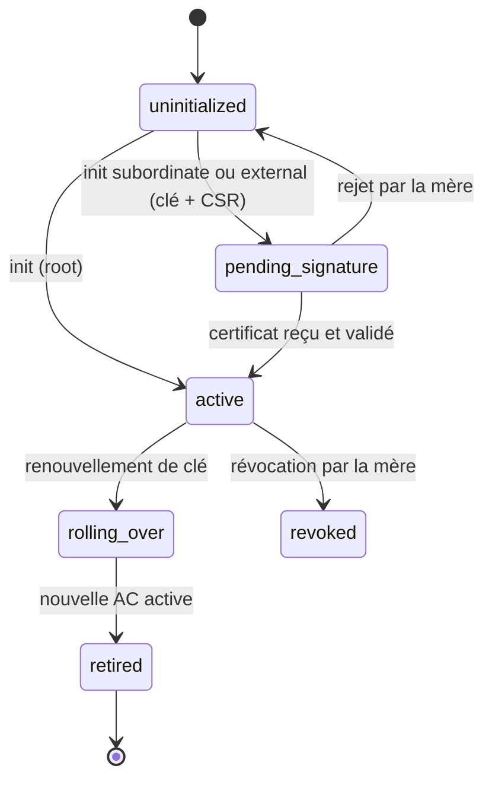
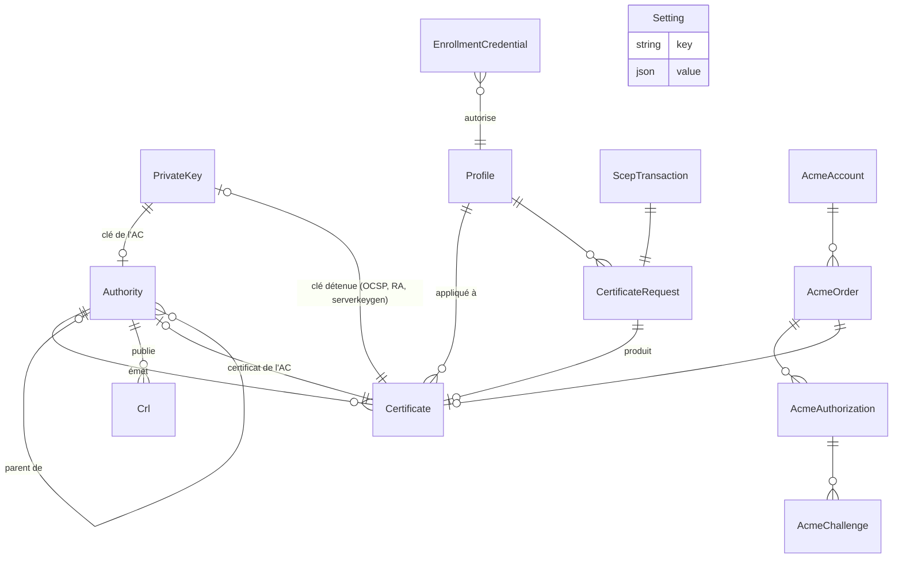
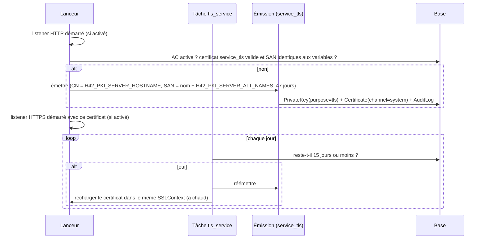

# Architecture — h42-pki

> Statut : **v1.1** (2026-11-22). Les phases 0 et 1 sont réalisées ; le document décrit l'existant et les décisions
> prises pour la suite (configuration en base, HTTP et HTTPS intégrés : ADR-0011 à 0014). Les décisions
> structurantes sont tracées dans `docs/adr/`. Les points marqués **« À vérifier »** doivent être confirmés par un
> spike avant implémentation.

## 1. Objectifs

1. Fournir, dans **un conteneur**, une autorité de certification complète correspondant à **un niveau** de hiérarchie.
2. Permettre à plusieurs conteneurs identiques de **se chaîner** : un conteneur démarré en mode « fille » obtient
   son certificat d'AC auprès d'un conteneur « mère ».
3. Offrir à chaque niveau les services de **révocation** (CRL, OCSP) et d'**enrôlement** (API, EST, SCEP, ACME).
4. Rester exploitable en homelab (SQLite, un seul processus) tout en permettant un durcissement
   (PostgreSQL, clé sur carte à puce / HSM via PKCS#11).
5. **Fonctionner seul** : HTTP et HTTPS servis par le conteneur lui-même, sans reverse-proxy obligatoire, avec un
   certificat HTTPS émis et renouvelé par sa propre AC (ADR-0012, ADR-0013).
6. **Un seul fichier de données** : configuration et données dans la base ; sauvegarder une AC = sauvegarder la base
   et la passphrase (ADR-0011).

### Non-objectifs (v1)

- Haute disponibilité multi-instance d'une même AC (une AC = un conteneur actif).
- Interface web graphique (l'API et la CLI suffisent ; une UI pourra venir plus tard).
- Certificats qualifiés eIDAS, Certificate Transparency, horodatage RFC 3161.

## 2. Vue d'ensemble

### 2.1 Hiérarchie type



Tous les conteneurs exécutent **la même image**. Ce qui les distingue : la façon dont leur AC a été initialisée
(`h42pki authority init`, cf. §3), la configuration en base et quelques variables d'environnement (nom d'hôte,
ports ; cf. §7). Chaque conteneur ne gère **qu'une seule AC active** à la fois (plus ses générations précédentes après
un renouvellement de clé — voir §8.3).

Une PKI de homelab n'a pas forcément trois niveaux : une racine seule peut émettre tous les profils. Rien n'est
réservé à un rang d'AC ; un profil se désactive au besoin sur une AC donnée (§4.2, ADR-0009).

### 2.2 Composants d'un conteneur

```mermaid
flowchart LR
    subgraph Conteneur h42-pki
      direction LR
      subgraph LCH["Lanceur (h42pki serve) — un processus"]
        LHTTP["Listener HTTP<br/>Uvicorn :8080"]
        LHTTPS["Listener HTTPS<br/>Uvicorn :8443<br/>mTLS facultatif"]
      end
      subgraph API["Couche API (FastAPI)"]
        ADM["/api/v1<br/>admin"]
        FED["/api/v1/federation"]
        PUB["/ca, /crl<br/>(publics, HTTP et HTTPS)"]
        OCSP["/ocsp"]
        EST["/.well-known/est"]
        SCEP["/scep"]
        ACME["/acme"]
      end
      subgraph SVC["Services (async)"]
        AS[AuthorityService]
        IS[IssuanceService]
        RS[RevocationService]
        CS[CrlService]
        OS[OcspService]
        FS[FederationService]
        PS[ProtocolServices<br/>EST / SCEP / ACME]
      end
      subgraph CORE["Core crypto (pur, synchrone)"]
        PROF[profiles]
        ISS[issuance builder]
        CRLB[crl builder]
        OCB[ocsp builder]
        CMS[cms / pkcs7]
      end
      KS["Keystore<br/>(software / pkcs11)"]
      DB[("Tortoise ORM<br/>SQLite / PostgreSQL<br/>données + configuration")]
      TSK["Tâches périodiques<br/>certificat HTTPS, CRL, purge, expirations"]
    end
    LHTTP --> API
    LHTTPS --> API
    TSK -. "certificat renouvelé (rechargement à chaud)" .-> LHTTPS
    API --> SVC
    SVC --> CORE
    SVC --> KS
    SVC --> DB
    TSK --> SVC
```



| Couche | Responsabilité | Règles |
|---|---|---|
| `server/` | Lanceur : listeners HTTP et HTTPS Uvicorn (`launcher.py`), `SSLContext` (`ssl_context.py`), protocole qui pose `h42pki.listener` et l'extension ASGI `tls` (`protocol.py`, `tls.py`), démarrage différé et rechargement à chaud du HTTPS, redémarrage d'un seul listener, battement de santé, signaux (`run.py`) | Aucune logique métier ; lit le certificat du serveur via les services (ADR-0012) |
| `api/` | HTTP : parsing, content-types, authentification, codes d'erreur, choix des routes selon le listener (`api/listener.py`), certificat client d'une requête (`api/client_cert.py`) | Aucune logique métier, aucun accès direct au keystore |
| `services/` | Orchestration : transactions DB, application des profils, audit | Async ; appelle `core` via `asyncio.to_thread` si coûteux |
| `core/` | Construction/vérification d'objets X.509, CRL, OCSP, CMS | Pur, synchrone, testable sans DB ni réseau (vérifié par `tests/unit/core/test_purity.py`) ; ses fonctions de clés (`core/keys.py`) ne sont appelées que par `keystore` |
| `keystore/` | Détention des clés privées, opérations de signature/déchiffrement | Seul composant qui détient la passphrase et (dé)chiffre une clé ; en v1 il remet l'objet `cryptography` au service, qui le passe aux builders de `core` (ADR-0004, cf. §8.1) |
| `models/` | Persistance Tortoise | Aucun import de `api` |
| `tasks/` | Tâches planifiées, lancées par le lanceur : renouvellement du certificat HTTPS (`tls_service.py`, ADR-0013) ; CRL, purges, expirations à venir | Idempotentes ; continuent en mode « à vide » (aucun listener) |

## 3. Modes de fonctionnement d'un conteneur

| Mode | Initialisation | Peut signer des AC filles | Profils émis |
|---|---|---|---|
| `root` | Génère sa clé + certificat auto-signé | Oui (si `pathLen` > 0) | Tous, chacun désactivable (`issuance.disabled_profiles`) |
| `subordinate` | Génère sa clé + CSR, s'inscrit auprès de la mère (fédération) | Oui si `pathLen` > 0 | Tous, chacun désactivable |
| `external` | Importe un certificat d'AC signé par une AC tierce (CSR exporté manuellement) | Selon `pathLen` | Tous, chacun désactivable |

> **Notice : certificat du serveur HTTPS.** Par souci de simplicité, **toute AC, même racine ou intermédiaire, et
> donc même sans le rôle de fournir des certificats serveur, s'émet un certificat serveur** : uniquement pour son
> propre serveur HTTPS, avec le profil interne `service_tls` (47 jours, renouvelé quand il reste 15 jours).
> C'est un écart volontaire et limité au principe « une racine ne signe que des AC » (ADR-0013).

Le mode `external` permet de rattacher h42-pki à une racine existante (AD CS, racine hors ligne sur clé USB, etc.).

Cycle de vie d'une AC locale (`Authority.status`) :



**Initialisation (lot 5a).** Le mode est choisi une fois pour toutes par la commande `h42pki authority init`, et non
par un réglage (précision apportée à l'ADR-0001). Mode `root` : nouvelle clé, certificat de la racine
(`--validity-days`, 3650 jours par défaut, de 1 à 10950 ; `--path-length` optionnel), `Authority(kind=local,
status=active)` (ADR-0010). Une seule AC locale non `retired` par conteneur. Les modes `subordinate` et `external`
arrivent avec la fédération (phase 2) : URL de la mère, invitation et empreinte sont passées à la commande, et
l'invitation n'est jamais stockée (ADR-0011).

**Avant l'activation** : l'AC n'a pas encore de certificat HTTPS, donc le listener HTTPS n'est pas démarré. Seuls
le listener HTTP (`/`, `/health`, publication) et la CLI sont disponibles ; `GET /health` indique `"https": "waiting"`.
Le lanceur regarde toutes les 5 secondes si une AC est active : dès qu'elle l'est (par exemple après `h42pki
authority init`, lancée par `docker exec` dans un autre processus), elle s'émet son certificat `service_tls` et le
lanceur ouvre le HTTPS sans redémarrage (ADR-0012, ADR-0013).

## 4. Modèle de données

### 4.1 Diagramme



`Setting` n'a pas de relation : c'est la configuration de l'instance (ADR-0011).

### 4.2 Tables principales

Toutes les tables ont `id` (UUID), `created_at`, `updated_at` (UTC aware).

> **État d'implémentation (phase 1.1).** Les tables `PrivateKey`, `Authority`, `Profile`, `Certificate`,
> `CertificateRequest`, `AuditLog`, `Setting` et `SettingsRevision` existent (`src/h42pki/models/`). Les champs
> marqués *(plus tard)* ne sont pas encore implémentés ; les autres tables (`Crl`, `EnrollmentCredential`, …)
> arrivent avec leur phase.
> Les clés étrangères pointent toujours « vers le bas » (Certificate → Authority / PrivateKey / Profile,
> CertificateRequest → Profile / Certificate) : pas de cycle (B27).

**`PrivateKey`** — clé détenue par ce conteneur.
Implémenté : `algorithm` (`core.keys.KeyAlgorithm` : `rsa2048|rsa3072|rsa4096|ec_p256|ec_p384|ed25519`),
`backend` (`software` ; `pkcs11` prévu dans l'enum), `encrypted_key` (forme protégée de la clé produite par le
keystore : pour le backend logiciel, **PKCS#8 DER chiffré** par la passphrase de l'AC avec `BestAvailableEncryption`),
`public_key_der`. Le nom `encrypted_key` est conservé (et non `encrypted_pkcs8`) parce que la colonne décrit la forme
propre au backend, pas un format.
Implémenté en phase 1.1 : `purpose` (`ca|tls` ; `tls` = clé du serveur HTTPS intégré, EC P-256, ADR-0013 ; `ca`
par défaut, y compris pour les clés créées par `POST /api/v1/private-keys`).
*(plus tard)* : `purpose` `ocsp|scep_ra|serverkeygen`, `pkcs11_uri` (backend pkcs11), `status`.

**`Authority`** — une AC connue de ce conteneur. L'AC locale est créée par `h42pki authority init` et lue par
`GET /api/v1/authority`.
Implémenté : `kind` (`local|parent|child`), `name` (unique ; `[a-z0-9-]`, 64 caractères, `chain` réservé : il entre
dans les URL `/ca/{name}.crt`), `status` (cf. §3 : `uninitialized|pending_signature|
active|rolling_over|retired|revoked`), `private_key` → `PrivateKey` (local uniquement, `RESTRICT`),
`parent` → `Authority` (FK sur soi, `RESTRICT`), `path_length`, `public_base_url` (préfixe des URLs AIA/CDP/OCSP
inscrites dans les certificats). Le **certificat de l'AC** est l'inverse de `Certificate.authority`
(`authority.certificate`) : une FK `Authority.certificate` formerait un cycle avec `Certificate.issuer`, que Tortoise
1.1.7 ne sait pas créer (B27). Un renouvellement de certificat d'AC passe donc par une nouvelle `Authority`, avec une
nouvelle clé et un nouveau nom (cf. §8.3).
*(plus tard)* : `federation_url` (pour `parent`/`child`), `name_constraints` (JSON).

**`Profile`** — gabarit d'émission. Les profils **intégrés** sont définis dans `core/profiles.py`, écrits en base au
démarrage et réalignés sur le code, en **lecture seule** (ADR-0009).
Implémenté : `name` (unique), `kind` (`sub_ca|tls_server|tls_client|ocsp_signer|device`), `description`, `builtin`,
`auto_approve` (émission immédiate ou approbation manuelle), `validity_days`, `max_validity_days`,
`basic_constraints`, `key_usage` (mêmes schémas que `core.extensions` ; `key_encipherment` n'est appliqué qu'aux clés
RSA), `extended_key_usage` (liste de **noms**, ADR-0006), `allowed_key_algorithms`, `subject_policy` (JSON :
attributs `required` / `allowed`, `cn_must_match_san`), `san_policy` (JSON : `types` parmi `dns|ip|email|uri`,
`required`), `ocsp_no_check`, `include_aia` (AIA caIssuers quand l'AC publie son certificat).
`internal` (vrai pour `service_tls` seulement : ni soumissible ni désactivable).
**Activation** : tous les profils sont utilisables par défaut, sur toute AC ; un profil se désactive par le réglage
`issuance.disabled_profiles` (ou `h42pki profile disable|enable NAME`), lu en base à chaque soumission. Un profil
désactivé est refusé à la soumission (422, audité `request.refuse`), et ses demandes `pending` ne peuvent plus
qu'être rejetées (l'approbation renvoie 409). L'API et `h42pki profile list` affichent `enabled`. Le réglage est
séparé de la table parce que les profils intégrés sont réalignés sur le code à chaque démarrage (ADR-0009).
*(plus tard)* : kinds `email|code_signing|custom`, motifs de domaines dans `san_policy`, valeurs fixées dans
`subject_policy`, `include_cdp`, `include_ocsp`, `must_staple`, `enabled_channels`, profils non intégrés et
édition.

| Profil | KU | EKU | Validité (défaut / max, jours) | SAN | Approbation |
|---|---|---|---|---|---|
| `sub_ca` | keyCertSign, cRLSign, digitalSignature | — | 1825 / 3650 | aucun | manuelle |
| `tls_server` | digitalSignature (+ keyEncipherment si RSA) | serverAuth | 90 / 200 (SC-081v3) | requis, dns/ip | auto |
| `tls_client` | digitalSignature | clientAuth | 365 / 825 | optionnel, dns/email/uri | auto |
| `ocsp_signer` | digitalSignature | OCSPSigning (+ OCSPNoCheck) | 30 / 90 | aucun | manuelle |
| `device` | digitalSignature (+ keyEncipherment si RSA) | clientAuth | 730 / 1095 | optionnel, dns/ip/uri | auto |
| `service_tls` *(interne)* | digitalSignature (+ keyEncipherment si RSA) | serverAuth | 47 (renouvelé à J-15) / 200 | `H42_PKI_SERVER_HOSTNAME` + `H42_PKI_SERVER_ALT_NAMES` (dns/ip, CN = premier nom) | sans objet : émis par l'AC pour son propre serveur, jamais via `/requests` (422, ADR-0013) |

**`Certificate`** — toujours enregistré **déjà signé** (le DER est la source de vérité).
Implémenté : `issuer` → `Authority` (null pour le certificat de la racine, émis par sa propre clé ; `RESTRICT`),
`authority` → `Authority` (OneToOne, renseigné quand le certificat est celui d'une AC), `profile` → `Profile` (null
pour la racine), `channel` (`cli|api`), `serial_hex` (unique par émetteur), `subject_dn` (texte RFC 4514),
`private_key` → `PrivateKey` (seulement pour les certificats dont la clé est détenue ici, comme celui de l'AC ;
`RESTRICT`), `public_key_der`, `der`, `sha256_fingerprint` (unique), `status` (`valid|revoked|expired`),
`not_before`, `not_after`, `revoked_at`, `revocation_reason` (enum RFC 5280), `invalidity_date`.
Le sujet structuré (JSON) et les extensions demandées ne sont plus stockés : ils se déduisent du DER, et les
extensions viennent du profil.
Le statut `expired` est calculé à la lecture depuis le lot 5b (B34) ; il n'est pas encore écrit en base.
Canal `system` depuis la phase 1.1 : certificat du serveur HTTPS intégré, avec sa demande (`requester = system`) et
sa clé (`private_key`, `purpose = tls`).
*(plus tard)* : `sans` (colonne de recherche), `ski`, `aki`, statut `on_hold` et `expired` persistant (phase 3),
canaux `est|scep|acme|federation`.

**`CertificateRequest`**
Implémenté : `csr_der`, `profile` → `Profile`, `status` (`pending|issued|rejected|failed` : l'approbation émet
aussitôt, il n'y a donc pas d'état `approved` ; `failed` = émission impossible au moment de l'approbation),
`requested_validity_days`, `requester`, `channel`, `certificate` → `Certificate` (OneToOne), `subject_dn` (sujet
demandé), `rejection_reason`, `decided_by` (`auto-approve` ou l'acteur), `decided_at`, `metadata` (JSON :
`ignored_extensions`, `validity_truncated`, `failure`).
Une demande qui ne respecte pas son profil est refusée (422) **sans être enregistrée** comme demande ; le refus est
toutefois audité (`request.refuse`, avec le profil, la raison et l'empreinte SHA-256 du CSR, B35).

**`Crl`**
`authority`, `crl_number` (entier monotone par AC), `is_delta`, `base_crl_number`, `this_update`, `next_update`, `der`.
La CRL courante = la plus récente non expirée ; les anciennes sont conservées pour audit.

**`EnrollmentCredential`** — secrets d'enrôlement partagés par EST/SCEP/fédération.
`kind` (`est_basic|scep_challenge|federation_token|acme_eab`), `identifier`, `secret_hash` (argon2/scrypt ;
pour `acme_eab`, clé HMAC chiffrée car elle doit être relue), `profile`, `expires_at`, `max_uses`, `use_count`,
`allowed_subjects` (motif).

**`AuditLog`** — `timestamp`, `actor`, `action`, `object_type`, `object_id`, `details` (JSON, sans secret) ;
`source_ip` *(plus tard)*. Actions enregistrées : `private_key.generate`, `private_key.delete`, `authority.init`,
`authority.update`, `request.submit`, `request.refuse`, `request.approve`, `request.reject`, `request.fail`,
`certificate.issue` (avec le canal), `profile.create`, `profile.realign`, `config.set` et `config.unset`, dans la
même transaction que l'opération. Acteur : `anonymous` pour l'API jusqu'à l'authentification (ADR-0008), `cli` pour la
ligne de commande, `system` pour la synchronisation des profils et les tâches planifiées (certificat HTTPS).

**`Setting`** — configuration de l'instance (ADR-0011). Une ligne par réglage **modifié** : `key` (`section.nom`),
`value` (texte JSON : un réglage peut être une simple chaîne, un nombre ou `null`), `updated_at`, `updated_by`. Les
défauts restent dans le code ; chaque écriture est validée par le schéma `RuntimeSettings`
(`core/settings_schema.py`), qui déclare aussi le niveau d'application du réglage (`hot`, `listener`, `process`).
Une valeur stockée qui ne passe plus la validation (schéma changé sans migration, ADR-0007) est ignorée avec un
avertissement. Liste des réglages : §7.
**`SettingsRevision`** — une seule ligne, compteur incrémenté dans la même transaction que chaque écriture ; le
serveur le relit toutes les 5 secondes pour prendre en compte une écriture de la CLI (un `max(updated_at)` ne
verrait pas un `unset`, qui supprime sa ligne).

Tables spécifiques aux protocoles (détails dans `docs/protocols/`) :
`ScepTransaction`, `AcmeAccount`, `AcmeOrder`, `AcmeAuthorization`, `AcmeChallenge`, `AcmeNonce`,
`ChildAuthorityEnrollment` (fédération).

### 4.3 Choix de persistance

- **Tortoise ORM** (déjà adopté). SQLite par défaut (`/data/h42pki.sqlite3`), PostgreSQL via `asyncpg` en option.
- Migrations : **aucune avant la première release** (ADR-0007), le schéma est créé par `generate_schemas=True`.
  Avant la release : **Aerich** ou outil natif de Tortoise 1.x (**À vérifier**), puis `generate_schemas` réservé aux tests.
- Les objets cryptographiques sont stockés en **DER** ; le PEM n'est produit qu'en sortie.
- Toute émission se fait dans une **transaction** (`in_transaction()`) : réservation du numéro de série, insertion,
  audit. Le numéro de CRL est incrémenté sous verrou (`select_for_update` en PostgreSQL ; processus unique en SQLite).

## 5. Flux principaux

### 5.1 Émission d'un certificat (tous canaux)

Il n'existe que deux producteurs de certificats (ADR-0010) : `AuthorityService.init_root` pour le certificat de
l'AC racine, et **`IssuanceService`** pour tout certificat signé par l'AC. Dans `IssuanceService`, tous les canaux
passent par `submit` puis, selon le profil, par l'émission immédiate ou par `approve` / `reject` ; la méthode privée
`_issue` est le **seul chemin d'émission** (appelée `issue()` dans les versions précédentes de ce document ; elle est
privée pour qu'aucun appelant ne contourne l'approbation).

```mermaid
sequenceDiagram
    participant C as Canal (API ; EST/SCEP/ACME/Fédération plus tard)
    participant IS as IssuanceService
    participant CSR as core.csr
    participant B as core.issuance
    participant K as Keystore
    participant DB as Base
    C->>IS: submit(csr, profile, validity_days?, actor)
    IS->>CSR: parse_csr : signature, algorithme, sujet, SAN, extensions ignorées
    IS->>B: plan_issuance(csr, profil, certificat de l'AC) : règles du profil, sans clé
    B-->>IS: plan ou 422 (rien n'est enregistré)
    IS->>DB: CertificateRequest pending + AuditLog
    alt profil auto_approve
        IS->>IS: _issue
    else approbation manuelle
        C->>IS: approve(id) ou reject(id, reason)
    end
    IS->>K: clé de l'AC (AC active et non expirée, sinon 503)
    IS->>B: build_issued(csr, profil, certificat et clé de l'AC) [to_thread]
    B-->>IS: certificat signé et vérifié
    IS->>DB: Certificate + demande issued + AuditLog (transaction)
    IS-->>C: demande (certificate_id)
```

Extensions posées par `core.issuance.build_issued` (indépendamment du CSR, dont les extensions ne sont jamais
recopiées) : `BasicConstraints` et `KeyUsage` critiques, `ExtendedKeyUsage` non critique, `SubjectKeyIdentifier`,
`AuthorityKeyIdentifier` (dérivé du SKI de l'émetteur), `SubjectAlternativeName` (critique si le sujet est vide),
`OCSPNoCheck` pour `ocsp_signer`. La validité est plafonnée par le profil et **ramenée au `not_after` de
l'émetteur** (`validity_truncated`) ; une AC fille reçoit un `pathLen` strictement inférieur à celui de l'émetteur.
**AIA (lot 5b)** : `AuthorityInformationAccess` caIssuers `{public_base_url}/ca/{authority}.crt`, non critique,
quand l'AC a une `public_base_url` (validée et normalisée : http ou https avec avertissement, hôte requis, ni requête
ni fragment, pas de barre finale) et que le profil a `include_aia` ; jamais sur le certificat de la racine. Changer
l'URL (`h42pki authority update`) ne touche pas les certificats déjà émis.
**À venir** : `CRLDistributionPoints` et OCSP (phase 3) : aucune URL n'est inscrite tant que le service correspondant
n'existe pas.

### 5.2 Révocation

`RevocationService.revoke(cert, reason, invalidity_date)` → met à jour `Certificate`, journalise, puis
**déclenche la régénération immédiate de la CRL** (et invalide le cache OCSP). Accessible via l'API d'admin,
ACME `revokeCert`, et la fédération (révocation d'une AC fille par sa mère).

### 5.3 Inscription d'une AC fille

Voir `docs/protocols/federation.md`. Résumé : invitation à usage unique créée sur la mère →
la fille génère clé + CSR et appelle `POST /api/v1/federation/enroll` → la mère applique le profil `sub_ca`
(contrôle `pathLen`, NameConstraints) → approbation automatique ou manuelle → la fille récupère certificat + chaîne.
Les échanges passent par le HTTPS intégré de la mère : la fille le valide par la chaîne de la hiérarchie **et** par
l'empreinte de la mère communiquée avec l'invitation. Pas de mTLS entre conteneurs en v1 (ADR-0003).

### 5.4 Certificat du serveur HTTPS intégré



Si l'AC n'est pas encore active, le lanceur attend et ouvre le HTTPS dès qu'elle le devient. En cas d'échec du
renouvellement, une nouvelle tentative a lieu le lendemain, avec un avertissement dans le journal et dans
`/health` (ADR-0013).

Mise en œuvre :
- émission par `IssuanceService.issue_service_certificate` (interne, absente de l'API) : nouvelle clé EC P-256
  (`purpose = tls`), CSR construit sur place (`core/csr.build_csr`), demande enregistrée sur le canal `system`, puis le
  même `_issue` que tout autre certificat ;
- décision d'émettre dans `core/service_tls.issue_reason` : aucun certificat, expiré, noms différents de
  `H42_PKI_SERVER_HOSTNAME` + `H42_PKI_SERVER_ALT_NAMES` (CN et ensemble des SAN), ou `tls_service.renew_before_days`
  jours ou moins avant l'expiration ;
- un changement des réglages `tls_service.*` (niveau `hot`) déclenche une vérification immédiate : c'est ainsi qu'on
  force un renouvellement (par exemple `validity_days` 90 puis `renew_before_days` 60) ;
- chargement dans l'`SSLContext` : la clé sort du keystore en **PKCS#8 chiffré** par un mot de passe à usage unique
  gardé en mémoire (`KeyStore.export_encrypted`), passe par un dossier temporaire `0700` (fichiers `0600`) supprimé
  aussitôt, et `load_cert_chain(..., password=…)` la déchiffre en mémoire (CLAUDE.md §6.2) ;
- pas d'émission quand `H42_PKI_HTTPS_ENABLED=false` : sans listener HTTPS, le certificat ne servirait à rien.

## 6. Surface HTTP

Deux listeners, servis par le lanceur (ADR-0012) : **HTTP** (`H42_PKI_HTTP_PORT`, 8080 par défaut) et **HTTPS**
(`H42_PKI_HTTPS_PORT`, 8443 par défaut), chacun désactivable. L'application choisit les routes selon le listener :
les routes publiques sont servies sur les deux, tout le reste **uniquement en HTTPS**.

Mise en œuvre : le protocole du lanceur pose `scope["extensions"]["h42pki.listener"]` (`"http"` ou `"https"`) sur
chaque requête ; un middleware ASGI (`api/listener.py`) laisse passer en HTTP `/`, `/health`, `/favicon.ico` et `/ca/*` seulement
(`/crl/*`, `/ocsp` et `/scep` s'y ajouteront avec leur phase) et renvoie pour tout le reste un `404`
`application/problem+json` (« this route is only served over HTTPS »), sans redirection. `/docs` et
`/openapi.json` sont donc HTTPS uniquement. Sans l'extension (application appelée directement, comme
`httpx.ASGITransport` dans les tests), toutes les routes répondent : ce mode est réservé aux tests.

| Préfixe | HTTP | HTTPS | Auth | Contenu |
|---|---|---|---|---|
| `/`, `/health` | oui | oui | aucune | `{"name", "version"}` ; santé : `status` (`ok`, `degraded`, `unavailable` → 503), `database`, `heartbeat_age_seconds`, `authority` (statut de l'AC locale), `listeners`, `https` (`serving`, `waiting`, `disabled`), `https_certificate` (`not_after`, `renewal` `ok`/`failing`), `warnings` — statuts seulement, jamais de secret |
| `/favicon.ico` | oui | oui | aucune | favicon du projet (`image/x-icon`, ICO 16/32/48 px, `src/h42pki/static/`, charte graphique), lu une fois au démarrage ; cache `ETag` / 304, `Cache-Control: public, max-age=86400` ; absent de l'OpenAPI |
| `/ca/{name}.crt`, `/ca/{name}.pem`, `/ca/chain.pem` | oui | oui | aucune | AIA caIssuers (DER), PEM, chaîne avec la racine — **implémenté (lot 5b)**, cache `ETag` / 304 |
| `/crl/{name}.crl`, `/crl/{name}-delta.crl` | oui | oui | aucune | CRL DER (`application/pkix-crl`) — phase 3 |
| `/ocsp` (POST), `/ocsp/{b64}` (GET) | oui | oui | aucune | `application/ocsp-request` / `-response` — phase 3 |
| `/scep[/{profile}]` (`pkiclient.exe` accepté) | oui | oui | challenge password | CMS (`application/x-pki-message`) — phase 5 |
| `/.well-known/est/[{label}/]...` | **non** | oui | certificat client (mTLS facultatif) ou Basic | PKCS#10 / PKCS#7 base64 — phase 4 |
| `/acme/...` | **non** | oui | JWS (RFC 8555) | `application/jose+json` — phase 6 |
| `/api/v1/federation/...` | **non** | oui | invitation à usage unique | JSON — phase 2 |
| `/api/v1/...`, `/docs`, `/openapi.json` | **non** | oui | aucune avant la release (ADR-0008), puis jeton d'API (Bearer) | JSON |
| `/metrics` | à définir | à définir | réseau privé | Prometheus — phase 7 |

**API d'administration implémentée (phase 1.1).** Schémas écrits à la main (`extra="forbid"`, snake_case), aucune
réponse ne contient de clé privée ; toutes les erreurs en `application/problem+json` (RFC 9457) : 404 objet inconnu,
409 conflit, 422 requête invalide (les erreurs de validation ajoutent une extension `errors` : `loc`, `msg`, `type`,
jamais la valeur soumise), 503 sans AC active, 500 si une clé stockée ne peut pas être déchiffrée. Les erreurs de
routage (404 route inconnue, 405 méthode non permise, avec l'en-tête `Allow`) sont aussi en `problem+json` (B46). Le schéma
`Problem` est déclaré dans l'OpenAPI pour 404, 409, 422 et 503 (`/openapi.json` ne contient plus
`HTTPValidationError`, B30).

| Méthode | Chemin | Réponse |
|---|---|---|
| POST | `/api/v1/private-keys` `{algorithm}` | 201 `{id, algorithm, backend, public_key_pem, created_at}` |
| GET | `/api/v1/private-keys/{id}` | 200, 404 |
| DELETE | `/api/v1/private-keys/{id}` | 204, 404, 409 (clé utilisée par un certificat ou une AC) |
| GET | `/api/v1/authority` | AC locale : `name`, `status`, `certificate_id`, `subject_dn`, `sha256_fingerprint`, dates, `path_length`, `key_algorithm`, `public_base_url` ; 404 si aucune |
| GET | `/api/v1/profiles` · `/api/v1/profiles/{name}` | profils (lecture seule ; 405 en écriture), avec `enabled` et `internal` |
| GET | `/api/v1/config` | `{items: [{key, value, default, origin, level, listeners, description, updated_at, updated_by}]}` : réglages effectifs ; 405 en écriture, qui se fait par la CLI jusqu'à l'authentification (ADR-0011) |
| POST | `/api/v1/requests` `{csr_pem, profile, validity_days?}` | 201, `status` = `issued` (avec `certificate_id`) ou `pending` ; 422 si le profil refuse la demande, est désactivé ou interne ; 503 sans AC active |
| GET | `/api/v1/requests` (`?status=`) · `/api/v1/requests/{id}` | demandes, avec `validity_truncated` et `ignored_extensions` |
| POST | `/api/v1/requests/{id}/approve` · `/api/v1/requests/{id}/reject` `{reason}` | décision manuelle ; 409 si déjà décidée, ou approbation d'un profil désactivé |
| GET | `/api/v1/certificates` (`status`, `profile`, `channel`, `q`, `limit` ≤ 500, `offset`) | `{items, total, limit, offset}`, plus récents d'abord ; `status` effectif (un `valid` échu est `expired`, B34) |
| GET | `/api/v1/certificates/{id}` | 200 `{id, serial_hex, subject_dn, status, not_before, not_after, sha256_fingerprint, profile, channel, issuer, issuer_id, sans, ca_issuers_url}` |
| GET | `/api/v1/certificates/{id}/chain.pem` | certificat puis émetteurs jusqu'à la racine incluse (`application/x-pem-file`) |
| GET | `/api/v1/certificates/{id}.pem` | `application/x-pem-file` |
| GET | `/api/v1/certificates/{id}.crt` | `application/pkix-cert` (DER) |

**Supprimés au lot 5a** (ADR-0010) : `POST /api/v1/certificates` et `POST /api/v1/certificates/{id}/self-sign`
(404/405). Une AC racine se crée par `h42pki authority init`.

**À venir** : jetons d'API (avant la release, ADR-0008), `/crl/*` et `/ocsp` (phase 3), protocoles d'enrôlement
(phases 4 à 6).

**TLS et mTLS (ADR-0012, validé par l'expérience `docs/spikes/2026-11-tls-launcher.md`).**
- Le listener HTTPS termine TLS lui-même (TLS 1.2 minimum) avec le certificat `service_tls` de l'AC (ADR-0013).
- **mTLS facultatif** (`CERT_OPTIONAL`) : un client peut se connecter avec ou sans certificat ; un certificat qui ne
  remonte pas à une ancre de confiance (par défaut la chaîne de l'AC locale) fait échouer la poignée de main.
- Le certificat client et sa chaîne vérifiée arrivent dans `scope["extensions"]["tls"]` (extension ASGI standard),
  grâce à un protocole Uvicorn personnalisé. Le code métier les lit par une seule fonction,
  `api/client_cert.client_certificate()` (utilisée par EST en phase 4).
- Uvicorn tourne **sans** en-têtes de proxy (`proxy_headers=False`) : l'adresse du client est celle du pair TCP, ce
  qui empêche un client de se faire passer pour un proxy de confiance avec `X-Forwarded-For`.
- **Reverse-proxy facultatif** : si `H42_PKI_TRUSTED_PROXIES` est renseigné, un certificat client transmis par un
  proxy dans l'en-tête `Client-Cert` (RFC 9440) est accepté depuis ces réseaux seulement ; le proxy doit supprimer
  tout en-tête entrant du même nom. Vide (par défaut) : l'en-tête est ignoré. La chaîne d'un certificat reçu ainsi
  n'est pas encore vérifiée par le serveur (B45, phase 4).
- Ports : 8080 et 8443 dans le conteneur (l'image tourne en non-root), publiés par Docker sur 80 et 443.

## 7. Configuration

> **Décision (ADR-0011)** : un seul fichier de données. Hors de la base, il n'y a que des **variables
> d'environnement lues au démarrage** ; tout le reste de la configuration est **en base**. Le fichier TOML et
> `H42_PKI_CONFIG` envisagés dans la v1 de ce document sont abandonnés. Mis en œuvre en phase 1.1.

### 7.1 Variables d'environnement

Liste fermée (`Settings`, `config.py`). Les changer impose de redémarrer le conteneur. Tout secret accepte une
variante `*_FILE` ou un secret Docker (`/run/secrets/h42_pki_<nom>`, dossier modifiable par `H42_PKI_SECRETS_DIR`) :
ces variables-là appartiennent au mécanisme de livraison des secrets, pas à la configuration.

| Variable | Défaut | Obligatoire | Rôle |
|---|---|---|---|
| `H42_PKI_DATABASE_URL` | `sqlite:///data/h42pki.sqlite3` dans l'image ; `sqlite://data/h42pki.sqlite3` (relatif) hors image | non | Connexion à la base |
| `H42_PKI_CA_PASSPHRASE` | — | **oui** (serveur, et commandes qui utilisent une clé) | Chiffrement des clés privées |
| `H42_PKI_SERVER_HOSTNAME` | — | **oui** (serveur) | FQDN du service : CN et premier SAN du certificat HTTPS |
| `H42_PKI_SERVER_ALT_NAMES` | vide | non | Noms supplémentaires du certificat HTTPS (DNS, noms courts admis, et IP), séparés par des virgules |
| `H42_PKI_ENVIRONMENT` | `production` | non | `dev`, `test` ou `production` |
| `H42_PKI_BIND_ADDRESS` | `0.0.0.0` dans l'image ; `127.0.0.1` hors image | non | Adresse IP d'écoute des listeners |
| `H42_PKI_HTTP_ENABLED` / `H42_PKI_HTTP_PORT` | `true` / `8080` | non | Listener HTTP |
| `H42_PKI_HTTPS_ENABLED` / `H42_PKI_HTTPS_PORT` | `true` / `8443` | non | Listener HTTPS |
| `H42_PKI_TRUSTED_PROXIES` | vide | non | Réseaux (CIDR) des reverse-proxys de confiance ; vide = aucun |

Contrôles au démarrage (arrêt avec un message clair) : variables obligatoires présentes ; `H42_PKI_SERVER_HOSTNAME`
est un vrai FQDN (au moins deux étiquettes `a-z0-9-` de 1 à 63 caractères, 253 au total, dernière étiquette non
numérique, ni IP ni joker ; mis en minuscules, point final retiré) ; noms supplémentaires valides et sans joker ;
ports distincts si les deux listeners sont actifs ; CIDR valides. Les deux listeners désactivés sont admis (mode
« à vide », §9). Mise en œuvre : règles de noms et de réseaux dans `core/hostnames.py`, cohérence des ports dans
`Settings` ; `H42_PKI_SERVER_HOSTNAME` et la passphrase ne sont exigés que par `h42pki serve` (code de sortie 2), pas
par les commandes qui n'en ont pas besoin.

### 7.2 Réglages en base

Table `Setting` (§4.2) ; seules les valeurs modifiées y sont écrites, les défauts restent dans le code. Écriture par
la CLI seulement jusqu'à l'authentification de l'API (`h42pki config show|get|set|unset` ; la valeur est lue en
JSON, ou prise comme texte si ce n'est pas du JSON), lecture par `GET /api/v1/config`. Les services relisent la base
à chaque usage (pas de cache) ; le lanceur relit le compteur `SettingsRevision` toutes les 5 secondes pour appliquer
ce qui le concerne. Chaque réglage déclare son niveau d'application :

- `hot` : immédiat, sans coupure ;
- `listener` : le lanceur redémarre seulement le listener concerné (coupure brève de ce port) ;
- `process` : au prochain redémarrage du conteneur.

| Réglage | Défaut | Niveau | Phase |
|---|---|---|---|
| `tls_service.validity_days` | 47 | hot | 1.1 |
| `tls_service.renew_before_days` | 15 | hot | 1.1 |
| `issuance.disabled_profiles` | `[]` | hot | 1.1 |
| `server.tls_min_version` | `tls1.2` | listener | 1.1 |
| `server.tls_ciphers` | défaut OpenSSL (TLS 1.2 seulement ; validé par OpenSSL à l'écriture) | listener | 1.1 |
| `server.client_trust_anchors` | `[]` : ancres ajoutées à la chaîne de l'AC locale (PEM d'AC) | listener (ajout comme retrait) | 1.1 |
| `server.keep_alive_timeout`, `server.limit_concurrency`, `server.backlog`, `server.max_header_size` | défauts Uvicorn | listener | 1.1 |
| `logging.level` | `info` | hot | 1.1 |
| `logging.format` | `text` | process | 1.1 |
| `database.pool_size` | défaut Tortoise (ignoré en SQLite) | process | 1.1 |
| `keystore.backend` | `software` | process | phase 7 |
| `crl.validity_hours` / `crl.regenerate_before_hours` / `crl.delta_enabled` | 168 / 48 / `false` | hot | phase 3 |
| `ocsp.enabled` / `ocsp.responder` / `ocsp.response_validity_hours` | `true` / `delegated` / 24 | hot | phase 3 |
| `est.enabled`, `est.default_profile`, `est.client_trust_anchors` | `false`, … | hot | phase 4 |
| `scep.enabled`, `scep.allow_legacy_crypto` | `false`, `false` | hot | phase 5 |
| `acme.enabled`, `acme.default_profile`, `acme.require_eab`, `acme.allowed_domains`, `acme.dns_resolvers` | `false`, `tls_server`, `false`, … | hot | phase 6 |

Les réglages `listener` HTTPS (`tls_*`, `client_trust_anchors`) ne redémarrent que le listener HTTPS ; les limites
Uvicorn (`keep_alive_timeout`, `limit_concurrency`, `backlog`, `max_header_size`) redémarrent les deux. Le nouveau
contexte TLS est construit **avant** l'arrêt de l'ancien listener : s'il échoue, l'ancien reste en service.

`Authority.public_base_url` n'est pas un réglage : il appartient à l'AC et se modifie par
`h42pki authority update`.

## 8. Sécurité

### 8.1 Clés privées

- **Interface implémentée** (`keystore/base.py`, lot 4) : protocole `KeyStore` avec `async generate(algorithm) ->
  StoredKey` (`encrypted_key`, `public_key_der`) et `async load(encrypted_key)` qui renvoie l'objet clé `cryptography`.
  Obtenue par `keystore.get_keystore(settings)` et passée explicitement aux services (dépendance FastAPI, pas de
  singleton). Le nom `KeyStore` évite la confusion avec l'enum `KeyBackend` (`software|pkcs11`) de `PrivateKey`.
- **À venir** (ADR-0004, phase 7) : `generate(algorithm, purpose)`, `sign(key_ref, data, hash)`,
  `decrypt(key_ref, data, padding)` (SCEP), `public_key(key_ref)`. `load()` n'aura pas d'équivalent PKCS#11.
- **Backend logiciel (v1)** : `SoftwareKeyStore`, PKCS#8 DER chiffré (`BestAvailableEncryption`) avec la passphrase
  du conteneur, stocké en base ; génération, chiffrement et déchiffrement dans des threads (`asyncio.to_thread`).
  La passphrase ne réside qu'en mémoire, n'apparaît ni dans les `repr` ni dans les messages d'erreur.
- **Backend PKCS#11 (phase 7)** : OpenSC et `PyKCS11` iront dans une variante `-pkcs11` de l'image (§9) et dans l'extra `pkcs11` du paquet. **Risque identifié** : `cryptography`
  n'accepte pas d'objet clé externe pour `CertificateBuilder.sign()` / `CertificateRevocationListBuilder.sign()` /
  `OCSPResponseBuilder.sign()`. Il faudra soit construire le TBS avec `asn1crypto`/`pyasn1` et y injecter la signature
  produite par le jeton, soit utiliser une bibliothèque tierce. **Spike obligatoire avant la phase 7**
  (cf. ADR-0004). C'est la raison pour laquelle toute signature passe par `keystore` dès la v1.

### 8.2 Clés de service

Pour limiter l'usage de la clé de l'AC :

- **Répondeur OCSP délégué** : certificat dédié (EKU `id-kp-OCSPSigning`, extension `id-pkix-ocsp-nocheck`,
  validité courte, renouvelé automatiquement).
- **Certificat RA SCEP** : clé RSA dédiée (le chiffrement CMS exige RSA + `keyEncipherment`), signée par l'AC.
- **Certificat du serveur HTTPS** : clé dédiée (`purpose = tls`), certificat `service_tls` de 47 jours
  renouvelé automatiquement (ADR-0013). La clé de l'AC n'est jamais utilisée pour TLS.

### 8.3 Renouvellement de l'AC

En v1, le seul renouvellement prévu est le **rollover avec nouvelle clé**, qui crée une **nouvelle `Authority`**
(nouvelle clé, nouveau certificat, **nouveau nom**, par exemple `home42-root-2036`) :
- deux contraintes l'imposent : une clé = une AC (B31) et le certificat d'une AC est l'inverse de
  `Certificate.authority`, sans clé étrangère depuis `Authority` (B27, §4.2) ;
- l'ancienne AC passe `rolling_over` puis `retired`. Elle reste publiée (`/ca/{ancien-nom}.crt`) et continuera à
  publier sa CRL et à répondre en OCSP (phase 3) pour ses certificats jusqu'à expiration du dernier ;
- les URL incluent le nom de l'AC (`/ca/{name}.crt`, `/crl/{name}.crl`), précisément pour que plusieurs générations
  coexistent.

Le renouvellement d'un certificat d'AC **avec la même clé** n'est pas prévu en v1.
Règle : une AC n'émet pas de certificat dont `not_after` dépasse le sien (la validité demandée est ramenée).

### 8.4 Authentification

| Canal | Mécanisme |
|---|---|
| API admin | **aucune jusqu'à la première release (ADR-0008)** ; ensuite jetons Bearer (hachés en base, portée `admin` / `operator` / `read`), créés par CLI. HTTPS seulement (depuis la phase 1.1). Configuration en écriture par la CLI seulement d'ici là (ADR-0011) |
| Fédération | invitation à usage unique créée sur la mère, sans secret long terme ; la fille vérifie la mère par la chaîne de la hiérarchie et par l'empreinte épinglée ; pas de mTLS entre conteneurs en v1 (ADR-0003) |
| EST | certificat client lu dans la connexion TLS (mTLS facultatif, ADR-0012) ou via un proxy de confiance (`Client-Cert`) ; sinon HTTP Basic |
| SCEP | challenge password (à usage unique, expirant, lié à un profil) ; renouvellement signé par l'ancien certificat |
| ACME | JWS de compte ; EAB (RFC 8555 §7.3.4) optionnel pour restreindre l'ouverture de compte |

## 9. Déploiement

État en place depuis la phase 1.1 (image non encore construite ni validée dans Docker sur le poste de
développement : scénario rejoué hors conteneur).

- **Image** : `python:3.13-slim` (ADR-0014), installation via `uv`, utilisateur non-root, un seul volume `/data`
  (la base, qui contient aussi la configuration). OpenSC/pcscd seulement dans une variante `-pkcs11` de l'image
  (phase 7).
- **Processus** : `h42pki serve`, le lanceur maison (ADR-0012), un seul processus. Il démarre le listener HTTP,
  puis le listener HTTPS dès que l'AC a son certificat `service_tls`, et les tâches planifiées. Granian n'est plus
  utilisé.
- **Ports** : 8080 (HTTP) et 8443 (HTTPS) dans le conteneur, publiés par Docker, par exemple
  `-p 80:8080 -p 443:8443`. Chacun peut être désactivé.
- **Mode « à vide »** : avec HTTP et HTTPS désactivés, le conteneur ne sert rien sur le réseau ; les tâches
  continuent et la CLI s'utilise par `docker exec`. Utile pour une racine hors ligne.
- **Santé** : `HEALTHCHECK` Docker par `h42pki healthcheck` (indépendant des ports : la base répond et le battement
  du lanceur a moins de 60 s) ; `GET /health` sur chaque listener actif pour la supervision et la future interface
  web. Le battement est un petit fichier du dossier temporaire (`h42pki-<empreinte de l'URL de la base>.heartbeat`),
  écrit toutes les 10 s et supprimé à l'arrêt : pas d'écriture en base toutes les 10 s, et `docker exec … h42pki
  healthcheck` retrouve le même fichier parce qu'il lit les mêmes variables.
- **Arrêt** : SIGTERM / SIGINT arrêtent proprement les deux listeners (chaque connexion ouverte a 5 s pour se
  terminer) et les tâches.
- **Développement** : `h42pki serve --reload` relance tout le processus lanceur (`watchfiles.run_process`) à chaque
  modification du paquet.
- **Exemple** :
  ```bash
  docker run -d --name pki-int \
    -e H42_PKI_CA_PASSPHRASE_FILE=/run/secrets/ca_passphrase \
    -e H42_PKI_SERVER_HOSTNAME=pki-int.home42.lan \
    -e H42_PKI_SERVER_ALT_NAMES=pki-int \
    -v pki-int-data:/data -p 80:8080 -p 443:8443 gilles67/h42-pki
  ```
- **`deploy/compose.yaml`** *(phase 2)* : racine + intermédiaire + émettrice, chacune avec le nom de son service
  dans `H42_PKI_SERVER_ALT_NAMES` pour que les conteneurs se joignent en HTTPS. Plus de reverse-proxy obligatoire ;
  un exemple avec proxy (`H42_PKI_TRUSTED_PROXIES`) pourra être fourni.
- **Sauvegarde** : un fichier (la base SQLite) et la passphrase. La perte de la passphrase rend les clés
  irrécupérables (à documenter dans un runbook d'exploitation, phase 7).

## 10. Choix techniques

| Besoin | Choix | Remarque |
|---|---|---|
| X.509, CSR, CRL, OCSP | `cryptography` ≥ 48 | `x509.ocsp` couvre requêtes et réponses |
| PKCS#7 certs-only (EST, SCEP GetCACert) | `cryptography.hazmat.primitives.serialization.pkcs7` | `serialize_certificates` |
| CMS SignedData/EnvelopedData (SCEP) | `asn1crypto` pour la structure + `cryptography` pour la crypto | Le support CMS de `cryptography` ne lit pas les attributs authentifiés SCEP — **À vérifier** l'étendue exacte en v48 |
| JWS/JWK (ACME) | `joserfc` (ou `josepy`) | Choix à confirmer en phase 6 ; JWS ACME = flattened JSON |
| Validation ACME | `httpx` (http-01), `dnspython` (dns-01), `ssl` (tls-alpn-01) | `httpx` et `dnspython` déjà présents via fastapi[standard] |
| Config | `pydantic-settings` pour les variables d'environnement ; table `Setting` validée par Pydantic pour le reste | ADR-0011 |
| Hachage de secrets | `argon2-cffi` (ou `hashlib.scrypt`) | |
| CLI | Typer | existant |
| Serveur HTTP/HTTPS | Uvicorn (version épinglée) + lanceur maison, protocole `h11` | ADR-0012 : Granian écarté (pas de certificat client transmis, pas de mTLS facultatif) |
| Python | 3.13 (CI 3.13 et 3.14) | ADR-0014 : chaîne vérifiée du certificat client |
| Tests | pytest, pytest-asyncio, httpx, time-machine, pytest-cov | voir `docs/testing.md` |
| Qualité | ruff, mypy | |
