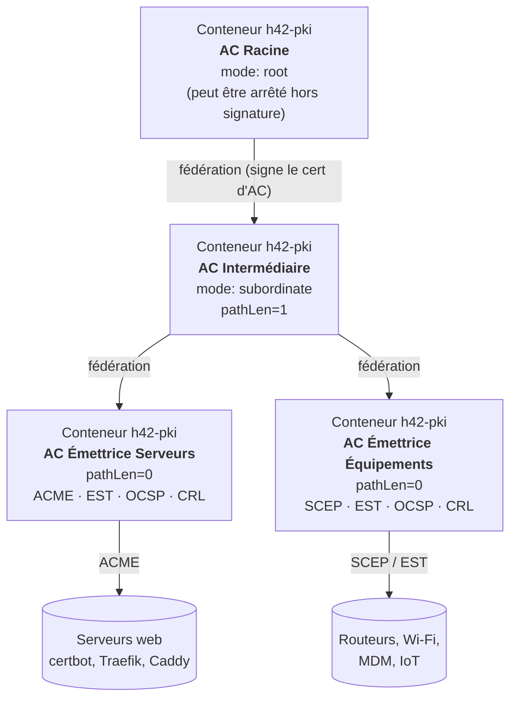
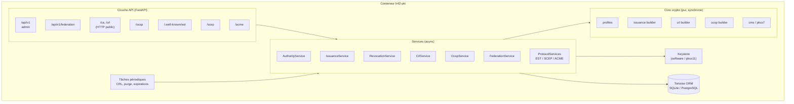
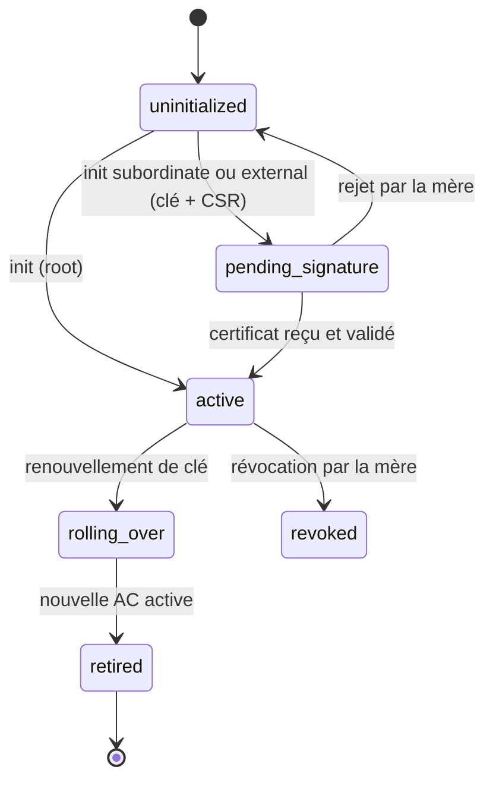
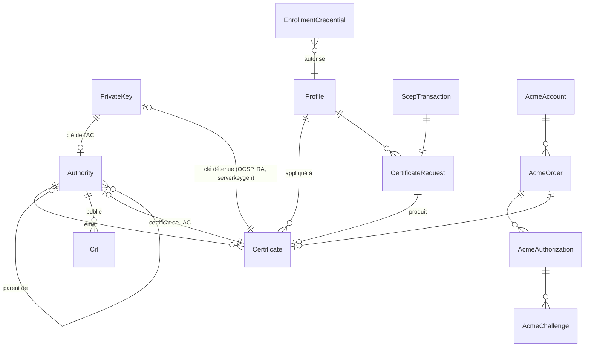

# Architecture — h42-pki

> Statut : **proposition v1** (2026-11). Les décisions structurantes sont tracées dans `docs/adr/`.
> Les points marqués **« À vérifier »** doivent être confirmés par un spike avant implémentation.

## 1. Objectifs

1. Fournir, dans **un conteneur**, une autorité de certification complète correspondant à **un niveau** de hiérarchie.
2. Permettre à plusieurs conteneurs identiques de **se chaîner** : un conteneur démarré en mode « fille » obtient
   son certificat d'AC auprès d'un conteneur « mère ».
3. Offrir à chaque niveau les services de **révocation** (CRL, OCSP) et d'**enrôlement** (API, EST, SCEP, ACME).
4. Rester exploitable en homelab (SQLite, un seul processus) tout en permettant un durcissement
   (PostgreSQL, clé sur carte à puce / HSM via PKCS#11).

### Non-objectifs (v1)

- Haute disponibilité multi-instance d'une même AC (une AC = un conteneur actif).
- Interface web graphique (l'API et la CLI suffisent ; une UI pourra venir plus tard).
- Certificats qualifiés eIDAS, Certificate Transparency, horodatage RFC 3161.

## 2. Vue d'ensemble

### 2.1 Hiérarchie type



Tous les conteneurs exécutent **la même image**. Seule la configuration (`mode`, URL de la mère, profils activés)
change. Chaque conteneur ne gère **qu'une seule AC active** à la fois (plus, temporairement, l'ancienne AC lors
d'un renouvellement de clé — voir §8.3).

### 2.2 Composants d'un conteneur



| Couche | Responsabilité | Règles |
|---|---|---|
| `api/` | HTTP : parsing, content-types, authentification, codes d'erreur | Aucune logique métier, aucun accès direct au keystore |
| `services/` | Orchestration : transactions DB, application des profils, audit | Async ; appelle `core` via `asyncio.to_thread` si coûteux |
| `core/` | Construction/vérification d'objets X.509, CRL, OCSP, CMS | Pur, synchrone, testable sans DB ni réseau (vérifié par `tests/unit/core/test_purity.py`) ; ses fonctions de clés (`core/keys.py`) ne sont appelées que par `keystore` |
| `keystore/` | Détention des clés privées, opérations de signature/déchiffrement | Seul composant qui détient la passphrase et (dé)chiffre une clé ; en v1 il remet l'objet `cryptography` au service, qui le passe aux builders de `core` (ADR-0004, cf. §8.1) |
| `models/` | Persistance Tortoise | Aucun import de `api` |
| `tasks/` | Tâches planifiées (lifespan FastAPI) | Idempotentes |

## 3. Modes de fonctionnement d'un conteneur

| Mode | Initialisation | Peut signer des AC filles | Services d'enrôlement |
|---|---|---|---|
| `root` | Génère sa clé + certificat auto-signé | Oui (si `pathLen` > 0) | Désactivés par défaut |
| `subordinate` | Génère sa clé + CSR, s'inscrit auprès de la mère (fédération) | Oui si `pathLen` > 0 | Selon configuration |
| `external` | Importe un certificat d'AC signé par une AC tierce (CSR exporté manuellement) | Selon `pathLen` | Selon configuration |

Le mode `external` permet de rattacher h42-pki à une racine existante (AD CS, racine hors ligne sur clé USB, etc.).

Cycle de vie d'une AC locale (`Authority.status`) :



**Initialisation (lot 5a).** Le mode `root` est choisi par la commande `h42pki authority init` (et non par un
réglage `authority.mode` comme l'envisageait ADR-0001) : nouvelle clé, certificat de la racine (`--validity-days`,
3650 jours par défaut, de 1 à 10950 ; `--path-length` optionnel), `Authority(kind=local, status=active)`
(ADR-0010). Une seule AC locale non `retired` par conteneur. Les modes `subordinate` et `external` arrivent
avec la fédération (phase 2).

Tant que l'AC n'est pas `active`, seuls `/health`, l'API d'admin et la fédération répondent ;
les endpoints d'enrôlement renvoient `503` (déjà le cas de `POST /api/v1/requests`).

## 4. Modèle de données

### 4.1 Diagramme



### 4.2 Tables principales

Toutes les tables ont `id` (UUID), `created_at`, `updated_at` (UTC aware).

> **État d'implémentation (lot 5a).** Les tables `PrivateKey`, `Authority`, `Profile`, `Certificate`,
> `CertificateRequest` et `AuditLog` existent (`src/h42pki/models/`). Les champs marqués *(plus tard)* ne sont pas
> encore implémentés. Les autres tables (`Crl`, `EnrollmentCredential`, …) arrivent avec leur phase.
> Les clés étrangères pointent toujours « vers le bas » (Certificate → Authority / PrivateKey / Profile,
> CertificateRequest → Profile / Certificate) : pas de cycle (B27).

**`PrivateKey`** — clé détenue par ce conteneur.
Implémenté : `algorithm` (`core.keys.KeyAlgorithm` : `rsa2048|rsa3072|rsa4096|ec_p256|ec_p384|ed25519`),
`backend` (`software` ; `pkcs11` prévu dans l'enum), `encrypted_key` (forme protégée de la clé produite par le
keystore : pour le backend logiciel, **PKCS#8 DER chiffré** par la passphrase de l'AC avec `BestAvailableEncryption`),
`public_key_der`. Le nom `encrypted_key` est conservé (et non `encrypted_pkcs8`) parce que la colonne décrit la forme
propre au backend, pas un format.
*(plus tard)* : `pkcs11_uri` (backend pkcs11), `purpose` (`ca|ocsp|scep_ra|tls|serverkeygen`), `status`.

**`Authority`** — une AC connue de ce conteneur. L'AC locale est créée par `h42pki authority init` et lue par
`GET /api/v1/authority`.
Implémenté : `kind` (`local|parent|child`), `name` (unique), `status` (cf. §3 : `uninitialized|pending_signature|
active|rolling_over|retired|revoked`), `private_key` → `PrivateKey` (local uniquement, `RESTRICT`),
`parent` → `Authority` (FK sur soi, `RESTRICT`), `path_length`, `public_base_url` (préfixe des URLs AIA/CDP/OCSP
inscrites dans les certificats). Le **certificat de l'AC** est l'inverse de `Certificate.authority`
(`authority.certificate`) : une FK `Authority.certificate` formerait un cycle avec `Certificate.issuer`, que Tortoise
1.1.7 ne sait pas créer (B27). Un renouvellement de certificat d'AC passe donc par une nouvelle `Authority`.
*(plus tard)* : `federation_url` (pour `parent`/`child`), `name_constraints` (JSON).

**`Profile`** — gabarit d'émission. Les profils **intégrés** sont définis dans `core/profiles.py`, écrits en base au
démarrage et réalignés sur le code, en **lecture seule** (ADR-0009).
Implémenté : `name` (unique), `kind` (`sub_ca|tls_server|tls_client|ocsp_signer|device`), `description`, `builtin`,
`auto_approve` (émission immédiate ou approbation manuelle), `validity_days`, `max_validity_days`,
`basic_constraints`, `key_usage` (mêmes schémas que `core.extensions` ; `key_encipherment` n'est appliqué qu'aux clés
RSA), `extended_key_usage` (liste de **noms**, ADR-0006), `allowed_key_algorithms`, `subject_policy` (JSON :
attributs `required` / `allowed`, `cn_must_match_san`), `san_policy` (JSON : `types` parmi `dns|ip|email|uri`,
`required`), `ocsp_no_check`.
*(plus tard)* : kinds `email|code_signing|custom`, motifs de domaines dans `san_policy`, valeurs fixées dans
`subject_policy`, `include_cdp`, `include_aia`, `include_ocsp`, `must_staple`, `enabled_channels`, profils non
intégrés et édition.

| Profil | KU | EKU | Validité (défaut / max, jours) | SAN | Approbation |
|---|---|---|---|---|---|
| `sub_ca` | keyCertSign, cRLSign, digitalSignature | — | 1825 / 3650 | aucun | manuelle |
| `tls_server` | digitalSignature (+ keyEncipherment si RSA) | serverAuth | 90 / 200 (SC-081v3) | requis, dns/ip | auto |
| `tls_client` | digitalSignature | clientAuth | 365 / 825 | optionnel, dns/email/uri | auto |
| `ocsp_signer` | digitalSignature | OCSPSigning (+ OCSPNoCheck) | 30 / 90 | aucun | manuelle |
| `device` | digitalSignature (+ keyEncipherment si RSA) | clientAuth | 730 / 1095 | optionnel, dns/ip/uri | auto |

**`Certificate`** — toujours enregistré **déjà signé** (le DER est la source de vérité).
Implémenté : `issuer` → `Authority` (null pour le certificat de la racine, émis par sa propre clé ; `RESTRICT`),
`authority` → `Authority` (OneToOne, renseigné quand le certificat est celui d'une AC), `profile` → `Profile` (null
pour la racine), `channel` (`cli|api`), `serial_hex` (unique par émetteur), `subject_dn` (texte RFC 4514),
`private_key` → `PrivateKey` (seulement pour les certificats dont la clé est détenue ici, comme celui de l'AC ;
`RESTRICT`), `public_key_der`, `der`, `sha256_fingerprint` (unique), `status` (`valid|revoked|expired`),
`not_before`, `not_after`, `revoked_at`, `revocation_reason` (enum RFC 5280), `invalidity_date`.
Le sujet structuré (JSON) et les extensions demandées ne sont plus stockés : ils se déduisent du DER, et les
extensions viennent du profil.
*(plus tard)* : `sans` (colonne de recherche), `ski`, `aki`, statut `on_hold` (phase 3), calcul de `expired` (B34),
canaux `est|scep|acme|federation`.

**`CertificateRequest`**
Implémenté : `csr_der`, `profile` → `Profile`, `status` (`pending|issued|rejected|failed` : l'approbation émet
aussitôt, il n'y a donc pas d'état `approved` ; `failed` = émission impossible au moment de l'approbation),
`requested_validity_days`, `requester`, `channel`, `certificate` → `Certificate` (OneToOne), `subject_dn` (sujet
demandé), `rejection_reason`, `decided_by` (`auto-approve` ou l'acteur), `decided_at`, `metadata` (JSON :
`ignored_extensions`, `validity_truncated`, `failure`).
Une demande qui ne respecte pas son profil est refusée (422) **sans être enregistrée** (B35).

**`Crl`**
`authority`, `crl_number` (entier monotone par AC), `is_delta`, `base_crl_number`, `this_update`, `next_update`, `der`.
La CRL courante = la plus récente non expirée ; les anciennes sont conservées pour audit.

**`EnrollmentCredential`** — secrets d'enrôlement partagés par EST/SCEP/fédération.
`kind` (`est_basic|scep_challenge|federation_token|acme_eab`), `identifier`, `secret_hash` (argon2/scrypt ;
pour `acme_eab`, clé HMAC chiffrée car elle doit être relue), `profile`, `expires_at`, `max_uses`, `use_count`,
`allowed_subjects` (motif).

**`AuditLog`** — `timestamp`, `actor`, `action`, `object_type`, `object_id`, `details` (JSON, sans secret) ;
`source_ip` *(plus tard)*. Actions enregistrées : `private_key.generate`, `private_key.delete`, `authority.init`,
`request.submit`, `request.approve`, `request.reject`, `request.fail`, `certificate.issue`, `profile.create`,
`profile.realign`, dans la même transaction que l'opération. Acteur : `anonymous` pour l'API jusqu'à
l'authentification (ADR-0008), `cli` pour la ligne de commande, `system` pour la synchronisation des profils.

Tables spécifiques aux protocoles (détails dans `docs/protocols/`) :
`ScepTransaction`, `AcmeAccount`, `AcmeOrder`, `AcmeAuthorization`, `AcmeChallenge`, `AcmeNonce`,
`ChildAuthorityEnrollment` (fédération).

### 4.3 Choix de persistance

- **Tortoise ORM** (déjà adopté). SQLite par défaut (`/data/h42pki.sqlite3`), PostgreSQL via `asyncpg` en option.
- Migrations : **aucune avant la première release** (ADR-0007), le schéma est créé par `generate_schemas=True`.
  Avant la release : **Aerich** ou outil natif de Tortoise 1.x (**À vérifier**), puis `generate_schemas` réservé aux tests.
- Les objets cryptographiques sont stockés en **DER** ; le PEM n'est produit qu'en sortie.
- Toute émission se fait dans une **transaction** (`in_transaction()`) : réservation du numéro de série, insertion,
  audit. Le numéro de CRL est incrémenté sous verrou (`select_for_update` en PostgreSQL ; processus unique en SQLite).

## 5. Flux principaux

### 5.1 Émission d'un certificat (tous canaux)

Il n'existe que deux producteurs de certificats (ADR-0010) : `AuthorityService.init_root` pour le certificat de
l'AC racine, et **`IssuanceService`** pour tout certificat signé par l'AC. Dans `IssuanceService`, tous les canaux
passent par `submit` puis, selon le profil, par l'émission immédiate ou par `approve` / `reject` ; la méthode privée
`_issue` est le **seul chemin d'émission** (appelée `issue()` dans les versions précédentes de ce document ; elle est
privée pour qu'aucun appelant ne contourne l'approbation).

```mermaid
sequenceDiagram
    participant C as Canal (API ; EST/SCEP/ACME/Fédération plus tard)
    participant IS as IssuanceService
    participant CSR as core.csr
    participant B as core.issuance
    participant K as Keystore
    participant DB as Base
    C->>IS: submit(csr, profile, validity_days?, actor)
    IS->>CSR: parse_csr : signature, algorithme, sujet, SAN, extensions ignorées
    IS->>B: plan_issuance(csr, profil, certificat de l'AC) : règles du profil, sans clé
    B-->>IS: plan ou 422 (rien n'est enregistré)
    IS->>DB: CertificateRequest pending + AuditLog
    alt profil auto_approve
        IS->>IS: _issue
    else approbation manuelle
        C->>IS: approve(id) ou reject(id, reason)
    end
    IS->>K: clé de l'AC (AC active et non expirée, sinon 503)
    IS->>B: build_issued(csr, profil, certificat et clé de l'AC) [to_thread]
    B-->>IS: certificat signé et vérifié
    IS->>DB: Certificate + demande issued + AuditLog (transaction)
    IS-->>C: demande (certificate_id)
```

Extensions posées par `core.issuance.build_issued` (indépendamment du CSR, dont les extensions ne sont jamais
recopiées) : `BasicConstraints` et `KeyUsage` critiques, `ExtendedKeyUsage` non critique, `SubjectKeyIdentifier`,
`AuthorityKeyIdentifier` (dérivé du SKI de l'émetteur), `SubjectAlternativeName` (critique si le sujet est vide),
`OCSPNoCheck` pour `ocsp_signer`. La validité est plafonnée par le profil et **ramenée au `not_after` de
l'émetteur** (`validity_truncated`) ; une AC fille reçoit un `pathLen` strictement inférieur à celui de l'émetteur.
**À venir** : `AuthorityInformationAccess` caIssuers (`{public_base_url}/ca/{authority}.crt`, lot 5b),
`CRLDistributionPoints` et OCSP (phase 3) : aucune URL n'est inscrite tant que le service correspondant n'existe pas.

### 5.2 Révocation

`RevocationService.revoke(cert, reason, invalidity_date)` → met à jour `Certificate`, journalise, puis
**déclenche la régénération immédiate de la CRL** (et invalide le cache OCSP). Accessible via l'API d'admin,
ACME `revokeCert`, et la fédération (révocation d'une AC fille par sa mère).

### 5.3 Inscription d'une AC fille

Voir `docs/protocols/federation.md`. Résumé : jeton d'inscription à usage unique créé sur la mère →
la fille génère clé + CSR et appelle `POST /api/v1/federation/enroll` → la mère applique le profil `sub_ca`
(contrôle `pathLen`, NameConstraints) → approbation automatique ou manuelle → la fille récupère certificat + chaîne.

## 6. Surface HTTP

| Préfixe | Transport | Auth | Contenu |
|---|---|---|---|
| `/health`, `/ready` | HTTP | aucune | statut JSON |
| `/ca/{name}.crt`, `/ca/{name}.pem`, `/ca/chain.pem` | **HTTP** | aucune | AIA caIssuers (DER), PEM, chaîne |
| `/crl/{name}.crl`, `/crl/{name}-delta.crl` | **HTTP** | aucune | CRL DER (`application/pkix-crl`) |
| `/ocsp` (POST), `/ocsp/{b64}` (GET) | HTTP | aucune | `application/ocsp-request` / `-response` |
| `/acme/...` | HTTPS | JWS (RFC 8555) | `application/jose+json` |
| `/.well-known/est/[{label}/]...` | **HTTPS** | mTLS ou Basic | PKCS#10 / PKCS#7 base64 |
| `/scep[/{profile}]` (`pkiclient.exe` accepté) | HTTP | challenge password | CMS (`application/x-pki-message`) |
| `/api/v1/federation/...` | HTTPS | jeton puis mTLS | JSON |
| `/api/v1/...` | HTTPS | aucune avant la release (ADR-0008), puis jeton d'API (Bearer) | JSON |
| `/` | HTTP | aucune | `{"name", "version"}` |
| `/metrics` | HTTP interne | aucune / réseau privé | Prometheus (phase 7) |

**API d'administration implémentée (lot 5a).** Schémas écrits à la main (`extra="forbid"`, snake_case), aucune
réponse ne contient de clé privée ; toutes les erreurs en `application/problem+json` (RFC 9457) : 404 objet inconnu,
409 conflit, 422 requête invalide (les erreurs de validation ajoutent une extension `errors` : `loc`, `msg`, `type`,
jamais la valeur soumise), 503 sans AC active, 500 si une clé stockée ne peut pas être déchiffrée.

| Méthode | Chemin | Réponse |
|---|---|---|
| POST | `/api/v1/private-keys` `{algorithm}` | 201 `{id, algorithm, backend, public_key_pem, created_at}` |
| GET | `/api/v1/private-keys/{id}` | 200, 404 |
| DELETE | `/api/v1/private-keys/{id}` | 204, 404, 409 (clé utilisée par un certificat ou une AC) |
| GET | `/api/v1/authority` | AC locale : `name`, `status`, `certificate_id`, `subject_dn`, `sha256_fingerprint`, dates, `path_length`, `key_algorithm`, `public_base_url` ; 404 si aucune |
| GET | `/api/v1/profiles` · `/api/v1/profiles/{name}` | profils (lecture seule ; 405 en écriture) |
| POST | `/api/v1/requests` `{csr_pem, profile, validity_days?}` | 201, `status` = `issued` (avec `certificate_id`) ou `pending` ; 422 si le profil refuse la demande ; 503 sans AC active |
| GET | `/api/v1/requests` (`?status=`) · `/api/v1/requests/{id}` | demandes, avec `validity_truncated` et `ignored_extensions` |
| POST | `/api/v1/requests/{id}/approve` · `/api/v1/requests/{id}/reject` `{reason}` | décision manuelle ; 409 si déjà décidée |
| GET | `/api/v1/certificates/{id}` | 200 `{id, serial_hex, subject_dn, status, not_before, not_after, sha256_fingerprint, profile, channel, issuer_id}` |
| GET | `/api/v1/certificates/{id}.pem` | `application/x-pem-file` |
| GET | `/api/v1/certificates/{id}.crt` | `application/pkix-cert` (DER) |

**Supprimés au lot 5a** (ADR-0010) : `POST /api/v1/certificates` et `POST /api/v1/certificates/{id}/self-sign`
(404/405). Une AC racine se crée par `h42pki authority init`.

**À venir** : publication `/ca/*`, liste des certificats et schéma `Problem` dans l'OpenAPI (lot 5b, B30), jetons
d'API (avant la release).

**TLS et mTLS.** Le serveur ASGI (Granian ou Uvicorn) peut terminer TLS lui-même, mais l'accès au certificat client
dans FastAPI dépend du serveur — **À vérifier**. Choix retenu pour v1 (cf. ADR-0005) : un **reverse-proxy**
(Traefik / Caddy / nginx) termine TLS et mTLS et transmet le certificat client dans un en-tête
(`X-Client-Cert`, PEM url-encodé). L'application n'accepte cet en-tête que si la requête provient d'une adresse
listée dans `trusted_proxies`. Un mode « TLS direct » pourra être ajouté ensuite.

Les endpoints HTTP (AIA/CRL/OCSP/SCEP) et HTTPS peuvent être exposés sur deux ports distincts (80/443) par le proxy.

## 7. Configuration

`pydantic-settings` (déjà présent dans `uv.lock`) : fichier TOML (`/config/h42pki.toml`, chemin surchargé par
`H42_PKI_CONFIG`) + variables d'environnement `H42_PKI_*` (priorité aux variables). Tout secret accepte une variante
`*_FILE` (Docker secrets).

```toml
[authority]
mode = "subordinate"            # root | subordinate | external
name = "home42-issuing-servers" # identifiant court, utilisé dans les URLs
public_base_url = "http://pki-srv.home42.lan"
key_algorithm = "ec_p384"
validity_days = 3650
path_length = 0

[authority.subject]
country_name = "FR"
organization_name = "Home42"
common_name = "Home42 Issuing CA - Servers"

[parent]                        # mode subordinate uniquement
federation_url = "https://pki-int.home42.lan"
enrollment_token_file = "/run/secrets/federation_token"
ca_bundle = "/config/parent-root.pem"   # ancre de confiance pour joindre la mère

[keystore]
backend = "software"            # software | pkcs11
passphrase_file = "/run/secrets/ca_passphrase"

[database]
url = "sqlite:///data/h42pki.sqlite3"

[crl]
validity_hours = 168
regenerate_before_hours = 48
delta_enabled = false

[ocsp]
enabled = true
responder = "delegated"         # delegated | ca
response_validity_hours = 24

[est]
enabled = true
[scep]
enabled = false
[acme]
enabled = true
default_profile = "tls_server"
require_eab = false

[server]
trusted_proxies = ["172.16.0.0/12"]
```

## 8. Sécurité

### 8.1 Clés privées

- **Interface implémentée** (`keystore/base.py`, lot 4) : protocole `KeyStore` avec `async generate(algorithm) ->
  StoredKey` (`encrypted_key`, `public_key_der`) et `async load(encrypted_key)` qui renvoie l'objet clé `cryptography`.
  Obtenue par `keystore.get_keystore(settings)` et passée explicitement aux services (dépendance FastAPI, pas de
  singleton). Le nom `KeyStore` évite la confusion avec l'enum `KeyBackend` (`software|pkcs11`) de `PrivateKey`.
- **À venir** (ADR-0004, phase 7) : `generate(algorithm, purpose)`, `sign(key_ref, data, hash)`,
  `decrypt(key_ref, data, padding)` (SCEP), `public_key(key_ref)`. `load()` n'aura pas d'équivalent PKCS#11.
- **Backend logiciel (v1)** : `SoftwareKeyStore`, PKCS#8 DER chiffré (`BestAvailableEncryption`) avec la passphrase
  du conteneur, stocké en base ; génération, chiffrement et déchiffrement dans des threads (`asyncio.to_thread`).
  La passphrase ne réside qu'en mémoire, n'apparaît ni dans les `repr` ni dans les messages d'erreur.
- **Backend PKCS#11 (phase 7)** : l'image contient déjà OpenSC et `PyKCS11`. **Risque identifié** : `cryptography`
  n'accepte pas d'objet clé externe pour `CertificateBuilder.sign()` / `CertificateRevocationListBuilder.sign()` /
  `OCSPResponseBuilder.sign()`. Il faudra soit construire le TBS avec `asn1crypto`/`pyasn1` et y injecter la signature
  produite par le jeton, soit utiliser une bibliothèque tierce. **Spike obligatoire avant la phase 7**
  (cf. ADR-0004). C'est la raison pour laquelle toute signature passe par `keystore` dès la v1.

### 8.2 Clés de service

Pour limiter l'usage de la clé de l'AC :

- **Répondeur OCSP délégué** : certificat dédié (EKU `id-kp-OCSPSigning`, extension `id-pkix-ocsp-nocheck`,
  validité courte, renouvelé automatiquement).
- **Certificat RA SCEP** : clé RSA dédiée (le chiffrement CMS exige RSA + `keyEncipherment`), signée par l'AC.

### 8.3 Renouvellement de l'AC

Renouvellement avec **nouvelle clé** (rollover) : l'ancienne AC passe `rolling_over` puis `retired` ; elle continue à
publier sa CRL et à répondre en OCSP pour ses certificats jusqu'à expiration du dernier certificat émis.
Les URLs incluent le nom de l'AC (`/crl/{name}.crl`) et non un nom générique, pour que plusieurs générations
coexistent. Règle : une AC n'émet pas de certificat dont `not_after` dépasse le sien.

### 8.4 Authentification

| Canal | Mécanisme |
|---|---|
| API admin | **aucune jusqu'à la première release (ADR-0008)** ; ensuite jetons Bearer (hachés en base, portée `admin` / `operator` / `read`), créés par CLI |
| Fédération | jeton d'inscription à usage unique, puis mTLS avec le certificat d'AC de la fille |
| EST | certificat client (réenrôlement, ou certificat émis par une AC de confiance configurée) ou HTTP Basic |
| SCEP | challenge password (à usage unique, expirant, lié à un profil) ; renouvellement signé par l'ancien certificat |
| ACME | JWS de compte ; EAB (RFC 8555 §7.3.4) optionnel pour restreindre l'ouverture de compte |

## 9. Déploiement

- Image unique basée sur `python:3.12-slim` (au lieu d'`ubuntu` + venv manuel), installation via `uv`, utilisateur
  non-root, `HEALTHCHECK`, volumes `/data` (base) et `/config` (configuration, secrets). OpenSC/pcscd seulement dans une
  variante `-pkcs11` de l'image.
- Serveur ASGI : **Granian** (déjà dans `requirements.txt`) ou Uvicorn — **un seul worker** en v1 (les tâches
  planifiées tournent dans le lifespan ; plusieurs workers dupliqueraient la génération de CRL).
- `deploy/compose.yaml` : racine + intermédiaire + émettrice + Traefik, pour le développement et les tests d'interop.
- Sauvegarde : base + configuration ; la perte de la passphrase rend la clé d'AC irrécupérable (à documenter
  dans un runbook d'exploitation).

## 10. Choix techniques

| Besoin | Choix | Remarque |
|---|---|---|
| X.509, CSR, CRL, OCSP | `cryptography` ≥ 48 | `x509.ocsp` couvre requêtes et réponses |
| PKCS#7 certs-only (EST, SCEP GetCACert) | `cryptography.hazmat.primitives.serialization.pkcs7` | `serialize_certificates` |
| CMS SignedData/EnvelopedData (SCEP) | `asn1crypto` pour la structure + `cryptography` pour la crypto | Le support CMS de `cryptography` ne lit pas les attributs authentifiés SCEP — **À vérifier** l'étendue exacte en v48 |
| JWS/JWK (ACME) | `joserfc` (ou `josepy`) | Choix à confirmer en phase 6 ; JWS ACME = flattened JSON |
| Validation ACME | `httpx` (http-01), `dnspython` (dns-01), `ssl` (tls-alpn-01) | `httpx` et `dnspython` déjà présents via fastapi[standard] |
| Config | `pydantic-settings` | déjà présent |
| Hachage de secrets | `argon2-cffi` (ou `hashlib.scrypt`) | |
| CLI | Typer | existant |
| Tests | pytest, pytest-asyncio, httpx, time-machine, pytest-cov | voir `docs/testing.md` |
| Qualité | ruff, mypy | |
