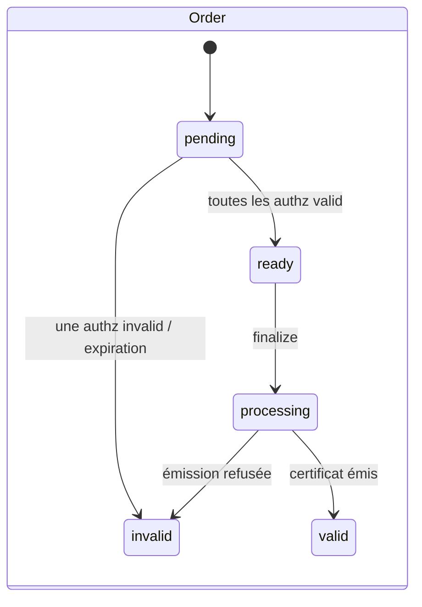

# ACME — Automatic Certificate Management Environment

Références : RFC 8555 (ACME), RFC 8737 (tls-alpn-01), RFC 8738 (identifiants IP), RFC 9773 (ARI, renouvellement),
RFC 7638 (empreinte JWK), RFC 7515 (JWS). Cible : certbot, lego, acme.sh, Traefik, Caddy, cert-manager.
Le plus gros chantier : à faire en dernier, une fois l'émission, la révocation et les profils stabilisés.

## 1. Ressources et URLs

Préfixe `/acme` ; un répertoire par profil possible (`/acme/{profile}/directory`), `/acme/directory` = `acme.default_profile`.

| Ressource | Méthode | Chemin |
|---|---|---|
| directory | GET | `/acme/directory` |
| newNonce | HEAD (200) / GET (204) | `/acme/new-nonce` |
| newAccount | POST | `/acme/new-account` |
| account | POST | `/acme/acct/{id}` |
| newOrder | POST | `/acme/new-order` |
| order | POST-as-GET | `/acme/order/{id}` |
| authorization | POST-as-GET / POST (désactivation) | `/acme/authz/{id}` |
| challenge | POST `{}` | `/acme/chall/{id}` |
| finalize | POST `{csr}` | `/acme/order/{id}/finalize` |
| certificate | POST-as-GET | `/acme/cert/{id}` → `application/pem-certificate-chain` |
| revokeCert | POST | `/acme/revoke-cert` |
| keyChange | POST | `/acme/key-change` |
| renewalInfo (ARI) | GET | `/acme/renewal-info/{cert-id}` (phase 6b) |

`directory.meta` : `termsOfService` (optionnel), `website`, `caaIdentities`, `externalAccountRequired`.
Toutes les URLs absolues sont construites depuis `acme.base_url` (et non depuis l'en-tête `Host`).

## 2. Couche JWS (`api/acme/jws.py`)

Toute requête POST est un JWS *flattened JSON* (`application/jose+json`). Vérifications, dans cet ordre :

1. En-tête protégé : `alg` ∈ {`RS256`, `ES256`, `ES384`, `EdDSA`} (jamais `none` ni HMAC) ; exactement un de `jwk`
   (uniquement `newAccount` et `revokeCert` par clé de certificat) ou `kid` (URL de compte existant, statut `valid`) ;
   `url` == URL exacte de la requête ; `nonce` présent.
2. Nonce : existe dans `AcmeNonce`, non expiré → **supprimé** (usage unique). Sinon `badNonce` (le client réessaie).
3. Signature vérifiée avec la clé du compte.
4. Payload : `""` pour POST-as-GET, sinon JSON validé par un schéma Pydantic.

Chaque réponse porte `Replay-Nonce` (nouveau nonce), `Link: <…/directory>;rel="index"`, `Cache-Control: no-store`.
Erreurs : `application/problem+json`, `type = urn:ietf:params:acme:error:<code>` (`badNonce`, `malformed`,
`unauthorized`, `accountDoesNotExist`, `badCSR`, `rejectedIdentifier`, `orderNotReady`, `badSignatureAlgorithm`,
`externalAccountRequired`, `connection`, `dns`, `incorrectResponse`, `tls`, `serverInternal`, `alreadyRevoked`).
Bibliothèque JWS : `joserfc` ou `josepy` — **choix à confirmer** en début de phase 6 (critères : EdDSA, flattened JSON,
calcul d'empreinte RFC 7638).

## 3. Machine à états

Authorization : `pending → valid | invalid | deactivated | expired | revoked`.
Challenge : `pending → processing → valid | invalid`.

## 4. Défis

`keyAuthorization = token + "." + base64url(empreinte_SHA256_RFC7638(jwk_compte))`.

| Type | Vérification | Remarques |
|---|---|---|
| `http-01` | `GET http://{domaine}/.well-known/acme-challenge/{token}` sur le port 80, corps == `keyAuthorization` (espaces de fin tolérés) | Suivre ≤ 10 redirections vers 80/443 ; timeout 10 s |
| `dns-01` | TXT `_acme-challenge.{domaine}` contient `base64url(SHA256(keyAuthorization))` | Obligatoire pour les jokers `*.` ; résolveur configurable (`acme.dns_resolvers`, utile en LAN) |
| `tls-alpn-01` | TLS sur 443, ALPN `acme-tls/1`, SNI = domaine ; certificat présenté avec SAN = domaine et extension critique `id-pe-acmeIdentifier` (`1.3.6.1.5.5.7.1.31`) = SHA-256(`keyAuthorization`) | `ssl` standard + `cryptography` pour lire l'extension |

- Validation exécutée en **tâche de fond** (asyncio) après le POST sur le challenge, avec réessais (3 tentatives,
  backoff) ; l'état est persistant en base pour survivre à un redémarrage.
- `acme.allowed_domains` (motifs) restreint les identifiants acceptés dès `newOrder` (`rejectedIdentifier`).
- Identifiants IP (RFC 8738) : `http-01` et `tls-alpn-01` uniquement, désactivés par défaut.
- Mode `acme.insecure_skip_validation` réservé aux tests (refusé au démarrage si `environment = production`).

## 5. Finalisation et certificat

- CSR (`base64url` DER) : signature valide, clé ≠ clé du compte, ensemble des SAN (et éventuel CN) **strictement égal**
  aux identifiants de la commande, sinon `badCSR`.
- Émission via `IssuanceService.issue(channel="acme", profile=…)` ; le profil fixe EKU/validité (90 jours par défaut).
- `notBefore`/`notAfter` demandés dans `newOrder` : refusés (`malformed`) sauf si `acme.allow_custom_validity`.
- Téléchargement : chaîne PEM (feuille + intermédiaires, sans racine).

## 6. Comptes

- `AcmeAccount` : `jwk` (JSON), `jwk_thumbprint` (unique), `status` (`valid|deactivated|revoked`), `contact` (liste),
  `tos_agreed_at`, `eab_credential` → `EnrollmentCredential`.
- `onlyReturnExisting` supporté. `keyChange` : JWS imbriqué (RFC 8555 §7.3.5).
- EAB (§7.3.4) : si `acme.require_eab`, `newAccount` doit contenir `externalAccountBinding` (JWS HS256 sur la `jwk`
  du compte, `kid` = identifiant EAB) ; la clé HMAC est générée par la CLI (`h42pki acme eab create`).

## 7. Tables

`AcmeNonce(value, expires_at)` purgée par tâche ; `AcmeOrder(account, status, expires_at, identifiers JSON, profile,
not_before, not_after, error JSON, certificate)` ; `AcmeAuthorization(order, identifier_type, identifier_value,
wildcard, status, expires_at)` ; `AcmeChallenge(authorization, type, token, status, validated_at, error JSON)`.
Réutilisation d'autorisations valides d'un même compte : optionnelle (`acme.authz_reuse_hours`, défaut 0 = désactivée).

## 8. Tests

- Unitaires : vérification JWS (alg interdit, `url` différente, nonce rejoué, `kid` inconnu) ; empreinte RFC 7638
  (vecteurs de la RFC) ; calcul `keyAuthorization` ; transitions de la machine à états ; contrôle CSR/identifiants.
- Intégration : client ACME minimal écrit dans les tests (`tests/helpers/acme_client.py`, basé sur la même lib JWS)
  déroulant compte → commande → défi (validateur simulé par injection de dépendance) → finalize → certificat → révocation.
- Interop : `lego` ou `certbot` (http-01, `--server http://…/acme/directory`) contre le serveur dans le compose
  d'interop, avec un conteneur cible servant le défi ; vérifier dns-01 avec un serveur DNS de test
  (`pebble-challtestsrv` ou CoreDNS).
