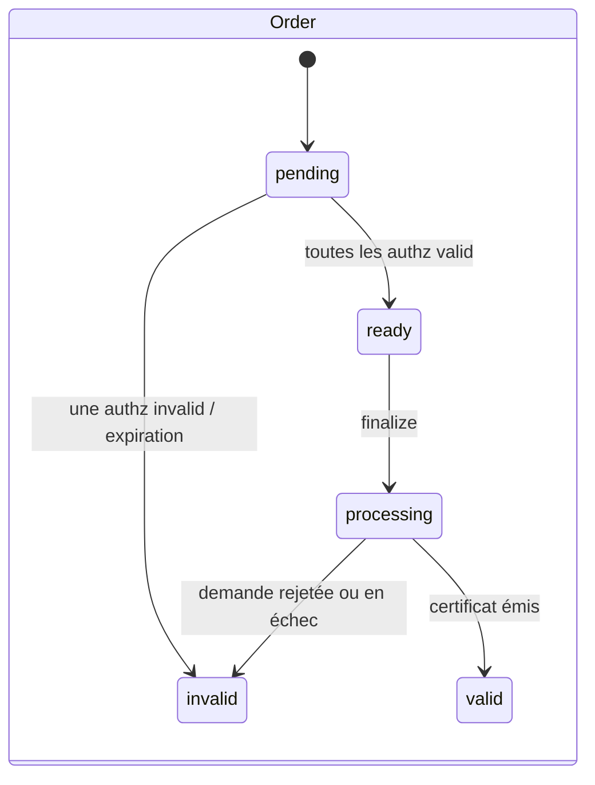

# ACME — Automatic Certificate Management Environment

Références : RFC 8555 (ACME), RFC 8738 (identifiants IP), RFC 7638 (empreinte JWK), RFC 7515 (JWS), RFC 8037
(EdDSA) ; au lot 6b RFC 9773 (ARI). Cible : certbot, lego, acme.sh, Traefik, Caddy, cert-manager.
Décisions : ADR-0020 (et ADR-0018 pour « désactivé par défaut »). Lot 6a en place depuis la phase 6.

## 1. Activation, ressources et URL

```bash
h42pki config set acme.enabled true                 # à chaud ; 404 partout tant que c'est faux
h42pki config set acme.base_url https://pki.example.test     # facultatif (défaut : hostname:port HTTPS)
```

HTTPS seulement. Un répertoire par profil ; `/acme/directory` = `acme.default_profile` (`tls_server`).

| Ressource | Méthode | Chemin |
|---|---|---|
| directory | GET | `/acme/directory`, `/acme/{profil}/directory` |
| newNonce | HEAD (200) / GET (204) | `/acme/new-nonce` |
| newAccount | POST (`jwk`) | `/acme/new-account` |
| account | POST (`kid`) : lecture, `contact`, `status: deactivated` | `/acme/acct/{id}` |
| orders | POST-as-GET | `/acme/acct/{id}/orders` |
| newOrder | POST | `/acme/new-order`, `/acme/{profil}/new-order` |
| order | POST-as-GET | `/acme/order/{id}` |
| authorization | POST-as-GET / POST `status: deactivated` | `/acme/authz/{id}` |
| challenge | POST `{}` (validation) / POST-as-GET | `/acme/chall/{id}` |
| finalize | POST `{csr}` | `/acme/order/{id}/finalize` |
| certificate | POST-as-GET | `/acme/cert/{id}` → `application/pem-certificate-chain` |
| revokeCert | POST (`kid` ou `jwk` du certificat) | `/acme/revoke-cert` |
| keyChange, renewalInfo | — | lot 6b |

`directory.meta` : `externalAccountRequired: false`, `profile` (profil du répertoire), `termsOfService` si
`acme.terms_of_service_url`. Toutes les URL absolues viennent de `acme.base_url`, jamais de l'en-tête `Host`.
Profil inconnu, interne ou désactivé → `404`.

## 2. Couche JWS (`core/acme/jws.py`, `services/acme/auth.py`)

Toute requête POST est un JWS *flattened JSON* (`application/jose+json`, sinon `415 malformed`). Vérifications, dans
cet ordre :

1. Structure : exactement `protected`, `payload`, `signature`, base64url strict sans remplissage.
2. En-tête protégé : `alg` ∈ {`RS256`, `ES256`, `ES384`, `EdDSA`} (sinon `badSignatureAlgorithm`) ; exactement un de
   `jwk` (seulement `newAccount` et `revokeCert`) ou `kid` (URL d'un compte `valid`) ; `url`, `nonce` ; pas de `crit`.
3. `url` == URL exacte de la requête (sinon `unauthorized`).
4. Nonce : existe et n'a pas expiré → **supprimé** (usage unique) ; sinon `badNonce` (la réponse porte un nouveau
   nonce, le client réessaie).
5. Clé : RSA ≥ 2048, EC P-256 / P-384, Ed25519 (`badPublicKey` sinon) ; signature (`malformed` si fausse).
6. Payload : `""` pour POST-as-GET, sinon objet JSON validé (champs inconnus ignorés, valeurs jamais recopiées dans
   l'erreur).

Chaque réponse porte `Replay-Nonce`, `Link: <…/directory>;rel="index"`, `Cache-Control: no-store`. Erreurs
`application/problem+json`, `type = urn:ietf:params:acme:error:<code>` : `accountDoesNotExist`, `alreadyRevoked`,
`badCSR`, `badNonce`, `badPublicKey`, `badRevocationReason`, `badSignatureAlgorithm` (avec `algorithms`),
`connection`, `dns`, `incorrectResponse`, `invalidContact`, `malformed`, `orderNotReady` (403),
`rejectedIdentifier`, `serverInternal`, `unauthorized` (403, ou 404 pour la ressource d'un autre compte),
`unsupportedContact`, `unsupportedIdentifier`.

Pas de bibliothèque JWS : implémentation sur `cryptography` (ADR-0020).

## 3. Machine à états (`core/acme/states.py`)



Authorization : `pending → valid` (un défi valide) `| invalid` (un défi échoué) `| expired | deactivated`.
Challenge : `pending → processing → valid | invalid`. Les statuts sont recalculés à chaque lecture ; après
`finalize`, la commande suit sa demande (`CertificateRequest`).

## 4. Défis (`services/acme/validation.py`)

`keyAuthorization = token + "." + base64url(empreinte_SHA256_RFC7638(jwk_compte))`.

| Type | Vérification | Identifiants |
|---|---|---|
| `http-01` | `GET http://{id}/.well-known/acme-challenge/{token}` (port 80, `[v6]`), corps == `keyAuthorization` (espaces de fin tolérés) ; ≤ 10 redirections vers 80/443 ; 10 s ; 8 Kio | noms DNS, adresses IP |
| `dns-01` | TXT `_acme-challenge.{nom}` contient `base64url(SHA256(keyAuthorization))`, résolveurs `acme.dns_resolvers` | noms DNS, jokers (seul défi) |

Pas de tls-alpn-01. Un joker `*.x` → autorisation sur `x` avec `wildcard: true`. Une adresse IP est refusée
(`rejectedIdentifier`) si le profil n'admet pas les SAN `ip` (`tls_server` les admet).

- Validation en **tâche de fond** après le POST `{}` sur le défi (`Retry-After: 2`) : 3 essais (immédiat, +5 s,
  +15 s), réservés par mise à jour conditionnelle (`attempts`, bail de 60 s dans `next_attempt_at`) ; la tâche `acme`
  du lanceur reprend toutes les 30 s (et au démarrage) les défis `processing` dont l'essai est dû.
- **Mode lab** `acme.insecure_skip_validation` : aucun contrôle, défi `valid` et `lab_validated` ; refusé en
  production à l'écriture et au démarrage ; avertissement (journal, `/health`) et mention dans l'audit de l'émission.
- Aucune restriction de domaines : risque accepté (ADR-0020).

## 5. Finalisation, certificat, révocation

- CSR (`base64url` DER) : signature valide, clé ≠ clé du compte, ensemble des SAN **strictement égal** aux
  identifiants, sujet vide ou CN parmi eux, sinon `badCSR` (la commande reste `ready`).
- Émission via `IssuanceService.submit(channel="acme", force_manual=acme.manual_approval)`, demandeur
  `acme:<id du compte>` ; le profil fixe EKU et validité (`tls_server` : 47 jours, 100 au plus). `notBefore` /
  `notAfter` de `newOrder` : refusés (`malformed`).
- Approbation (profil manuel ou `acme.manual_approval`) : commande `processing` + `Retry-After`
  (`acme.retry_after_seconds`, 60) ; `h42pki request approve` → `valid` ; `reject` → `invalid` avec le motif.
- Téléchargement : `application/pem-certificate-chain`, feuille puis intermédiaires, sans la racine.
- `revokeCert` : `kid` du compte qui a obtenu le certificat ou `jwk` du certificat ; `reason` 0, 1, 3, 4, 5, 9
  (sinon `badRevocationReason`) ; `RevocationService` (CRL, cache OCSP) ; déjà révoqué → `alreadyRevoked`.

## 6. Comptes

- `AcmeAccount` : `jwk` (JSON public, membres RFC 7638), `jwk_thumbprint` (unique), `status`
  (`valid|deactivated|revoked`), `contact` (`mailto:` seulement, 10 au plus), `tos_agreed_at`.
- Ouverts à tous en 6a. `onlyReturnExisting` ; compte existant → `200` + `Location`.
- Administration : `GET /api/v1/acme/accounts[/{id}]`, `POST /api/v1/acme/accounts/{id}/deactivate` ;
  `h42pki acme account list|show|deactivate`. Audit `acme.account.create|update|deactivate`, `acme.order.create`,
  `acme.challenge.respond|validate`, `acme.order.finalize` (jamais de jeton ni de nonce).
- Lot 6b : `keyChange` (JWS imbriqué), EAB (`acme.require_eab`, clé HMAC générée par la CLI).

## 7. Tables

`AcmeNonce(value, expires_at)` ; `AcmeAccount` ; `AcmeOrder(account, profile, status, expires_at, identifiers JSON,
error JSON, request, certificate)` ; `AcmeAuthorization(order, identifier_type, identifier_value, wildcard, status,
expires_at)` ; `AcmeChallenge(authorization, type, token, status, validated_at, error JSON, attempts,
next_attempt_at, lab_validated)`. Pas de réutilisation d'autorisations (une autorisation par commande).

Réglages (`hot`) : `acme.enabled`, `default_profile`, `base_url`, `terms_of_service_url`, `insecure_skip_validation`,
`manual_approval`, `retry_after_seconds` (60), `nonce_lifetime_minutes` (60), `authorization_lifetime_hours` (168),
`order_lifetime_hours` (168), `dns_resolvers`.

## 8. Tests

- Unitaires : JWS (vecteurs RFC 7638, 7515, 8037 ; `alg` interdit, `jwk` et `kid`, base64 non canonique, signature
  fausse, clés refusées), `keyAuthorization`, identifiants (jokers, IP), contrôle du CSR, transitions.
- Intégration : client minimal `tests/acme_client.py` (signature `tests/acme_jws.py`), validateur remplacé
  (`app.state.acme_validation.checker`) : désactivé → 404, répertoires, comptes, nonces, commande → défi → finalize →
  chaîne, jokers et dns-01, IP, mode lab, approbation manuelle, `revokeCert` (CRL et OCSP), administration ;
  http-01 réel contre un serveur HTTP local, dns-01 réel contre un serveur DNS local (`dnspython`).
- Interop : `deploy/acme-test.sh` (lego 5.8.1, certbot 5.10.0, pebble-challtestsrv 2.8.0).
